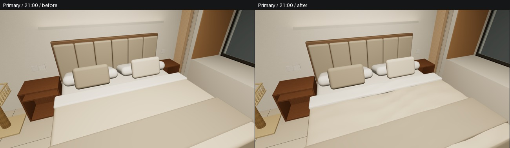
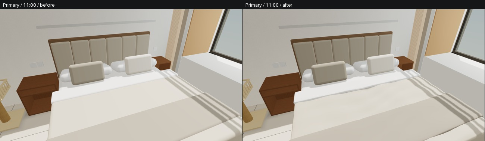
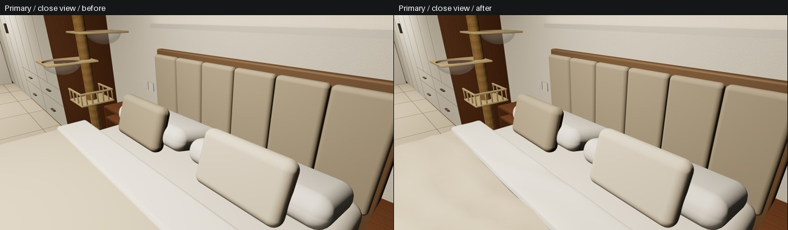
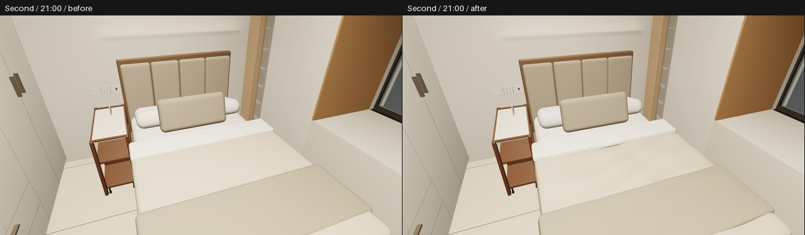
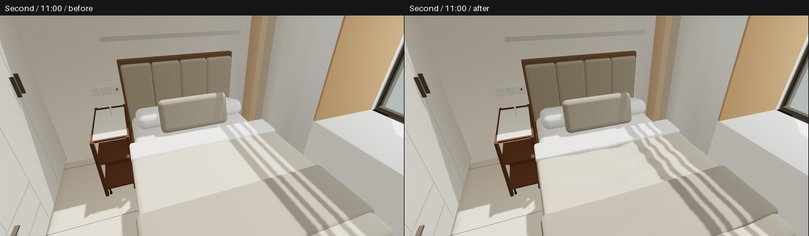

# 1601 床品和床头软包

2026-11-22。基线 `06e26965`。沿 1601 的 1800 × 2000 mm 双人床和 1200 × 2000 mm 单人床、原 `bed` 类型及已选米色。床架、床垫、床头分栏、枕靠数量和摆向沿原构造。借鉴 [Set the Mood](https://sael.net/interior/) 用相同机位对照柔软材质在自然光和灯光下的表现。对话附图展示的是参考应用的整屋界面，未提供两张床的同型号实物和织物参数。尺寸采用 Furnish 现有记录，织纹、褶皱和微表面属于外观假设。

## 轮廓、分件与材质

| 评估项 | 生产实现 | 目视复核 |
| --- | --- | --- |
| 被芯和翻边的轮廓 | 被芯、白色翻边与床尾巾继续分件。下凹褶皱、滚边由封闭网格表达，起伏会改变边缘轮廓与窗框投影。褶谷轻微压暗模拟短程自遮蔽。 | 主卧窗光下，被面边和窗框阴影可见起伏。床尾巾与被面、白翻边保持不同层次。 |
| 床头和枕靠织纹 | 布面纹理与法线离线生成并共用。每 9 mm 的床品纹理和每 13 mm 的软包纹理含八组经纬交织。UV 按各件的局部米制坐标采样。 | 近景可辨软包经纬，房间尺度下随 mipmap 淡出。次卧仍沿单人床的实体宽度和单套枕靠，织纹不随宽度缩放。 |
| 掠射光泽 | 床单与被芯采用较轻织物光泽，软包、靠枕及床尾巾用较宽的低强度光泽。 | 灯光下软包仍偏哑，掠射角有柔软亮边。保留暖米色与白色床单的关系。 |

## 生产与 M6 复核

- Node 生产实测覆盖两个宽度的 UV、褶面向上射线、单位法线及旋转、镜像、抬高后的 Three 和数值实体一致性。软床尾巾每侧仍外伸 25 mm，刚性床头最高位置仍是 1080 mm，原离地控制沿共享产品规则。项目字段及旧项目格式沿用，床的空间确认签名按生产几何版本更新。床模型原本不使用位置随机值，去掉位置依赖后，拖动沿原局部几何复用。
- 正式 Electron 生产导出的主卧床 GLB 经 Blender 插件隔离后台回读。读取 17 个网格、7 个带法线与基色贴图的光泽材质、3 个带褶谷顶点色的网格，包络约 2.000 × 1.850 × 1.080 m。生产导出 SHA-256 和读回槽信息见 [测量](measurements.json)及[读回](readback.json)。该床属于既有通用参数化模型，单独固定型号发布和实物配光校准不适用。
- 正式快捷方式的隔离 Electron，Apple M6 ANGLE Metal，流畅观察 2840 × 1554。21:00 主灯开、临时显示灯层，低位夜灯关，ACES 曝光 10。11:00 日景主灯关，曝光 1.05。主机位眼高 1660 mm。GTAO、SMAA、Bloom 及光追关闭。主卧保持 197 次绘制，三角形 63962→71150。次卧保持 481 次绘制，三角形 147747→160783。
- 主卧旋转 P50/P95 为 16.7/18.8→16.6/18.7 ms，平移 16.7/18.6→16.7/17.6 ms，拖床 30.2/166.2→30.5/163.5 ms。两版均有 45 次有效位姿更新，完成后显式撤销并核对。拖床仍有原来的长帧，本轮关注新衣料与几何的增量开销。
- 已运行床品回归、适用模型空间验证及阴影缓存检查。未运行全量、窄屏和实物试装。衣料为静态形态，未模拟松弛、接触动力学或纤维方向的完整光学。软包纹理近景细微，床品外观为技术样板，待用户按实物选型确认。

[机位](rooms.json) 与 `FURNISH_RASTER_ROUND=bed-bedding FURNISH_RASTER_RUNS=before,after` 复现。原生图、导出及逐帧报告在 `output/desktop-verification.noindex/room-raster-clqDAF.noindex/`。正式工作区前后哈希相同。
