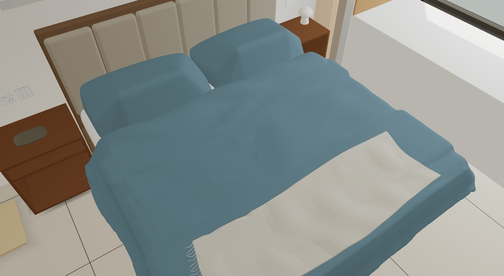
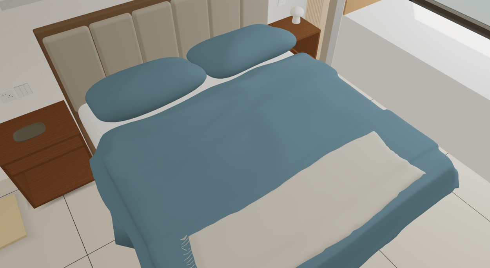
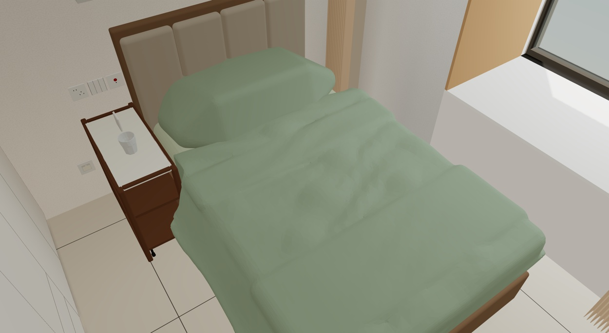
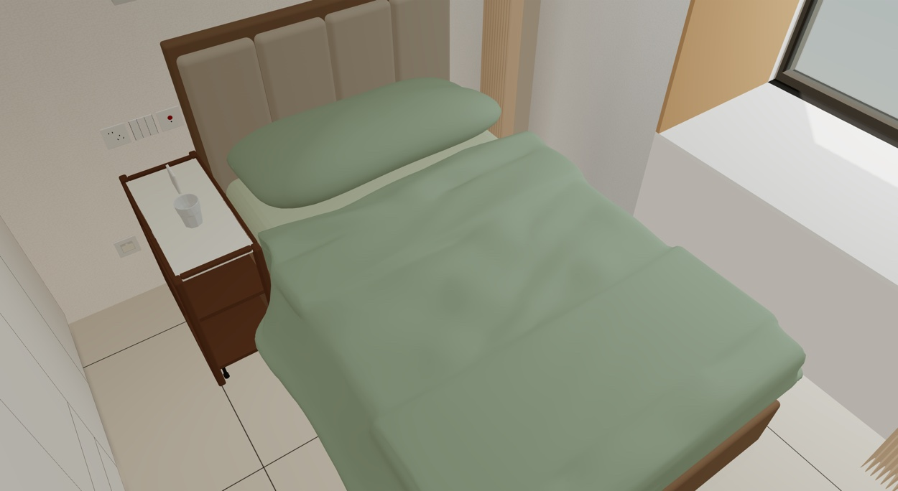
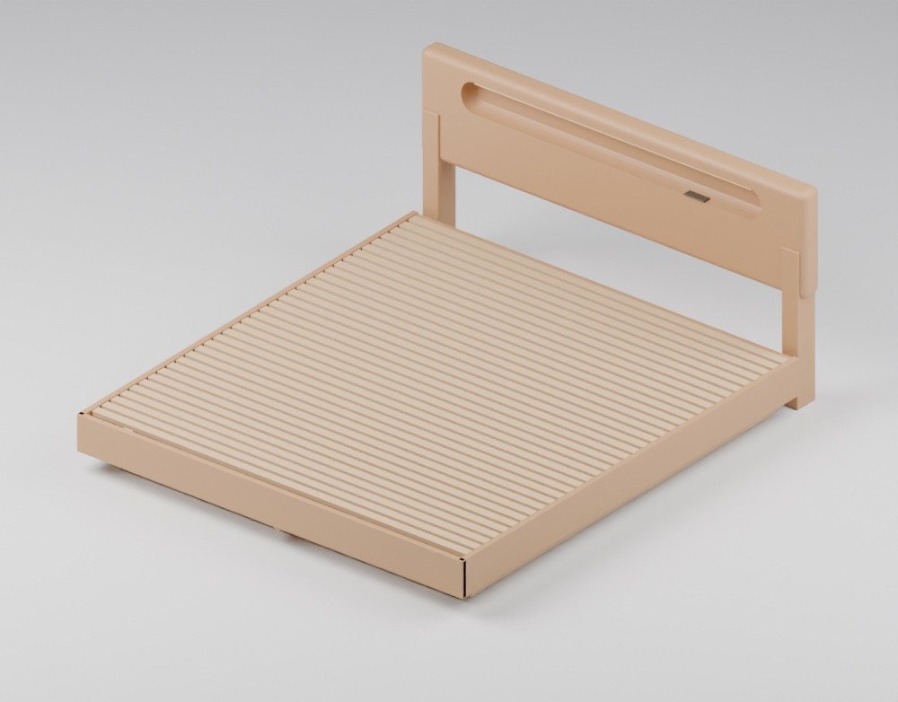
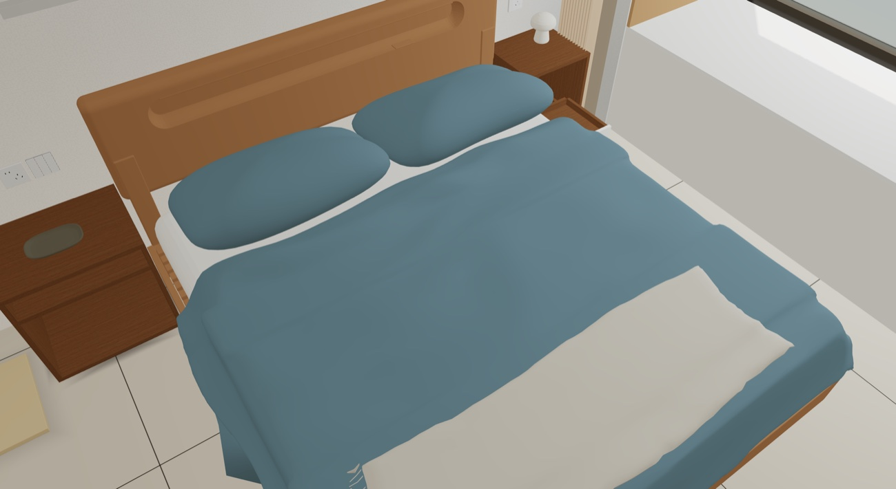

# 1601 两套独立床品精修

2026-11-24。目标是 1601 主卧蓝色 LUKTJASMIN 双枕、次卧浅灰绿 ÄNGSLILJA 单枕，以及主卧同场 HORNMAL 床尾毯。实际复现发现原床的示意织物和独立床品是两套几何。独立床品新版采用 Blender 5.3.0 建模，可编辑工程、GLB 和 Furnish OBJ 位于 [资产目录](../../../assets/models/1601-bedding/v2/)。

## 资料与形态

- 用户附图 SHA-256 为 `a33e06991ac2a2735075aa7e53307482f39c880f04b14c361909904850ffc0db`，用来定位既有搭配及粗糙区域。实际查看了主卧局部 (230,85,960,885) 和次卧局部 (1200,740,850,830)。按用户补充查看 [源氏木语已存商品布局图](../../../assets/models/sofa-bed/references/product-page/04.jpg)，参考低靠枕和床面分层关系。
- 蓝色棉／莱赛尔缎织为 2000 × 2300 mm 被套和两只 500 × 800 mm 枕套。绿色水洗棉为 1500 × 2000 mm 被套和一只 500 × 800 mm 枕套。灰白篮织毯商品尺寸为 1300 × 1700 mm，采用原有画面里的床尾折搭。商品展开尺寸与铺在床上的模型包络分别记录。 [蓝色套件](https://www.ikea.cn/cn/zh/p/luktjasmin-lu-ke-te-ya-si-min-bei-tao-he-2-ge-zhen-tao-hui-lan-se-40484425/) · [灰绿色套件](https://www.ikea.cn/cn/zh/p/60632458/) · [床尾毯](https://www.ikea.cn/cn/zh/p/hornmal-throw-off-white-00529096/)
- 枕芯蓬松高度、被面褶皱及折搭高度沿项目旧网格和图像估计。围边和下垂形态保持原有覆盖范围。床尾毯由蓝色被面射线确定承托高，保留 24 根具名流苏，实际落点见 [placement.json](../../../assets/models/1601-bedding/v2/placement.json)。缝制、按扣及纤维微表面仅做可见外观近似。
- [建模脚本](../../../scripts/blender-model-1601-bedding.py)读取三件既有自定义家具及其 OBJ，原料快照另存在本地验证目录。两套被枕保留原宽、深、高、离地、方向及颜色。床尾毯保留原平面包络，随贴合后的实际布面调整自身高与底部离地。

## 同机位成品对照

| 房间 | 修改前 | 修改后 |
| --- | --- | --- |
| 主卧 |  |  |
| 次卧 |  |  |

隔离 Apple Metal 桌面使用同一份 1601 方案副本、11:00 日光和每房两个固定机位。目标分别是枕头硬折角、被面分面阴影与床尾毯穿插。新版枕体采用渐薄轮廓，褶面以实际网格表达宽窄不同的形变，床尾毯保留完整浅色覆面。新增独立床品后隐藏两张床的示意被褥和枕头，旧装饰枕穿透消失。原床头、床架和床垫沿原构造。

## 生产验证

- 通过。隔离桌面使用「品牌家具／模型」导入 OBJ，通过属性隐藏两张床的示意床品，保存并刷新读回。两组都走生产 GLB 导出及全网格法线检查。源 BLEND 和 GLB 保留独立部件与材质，生产 OBJ 使用项目家具配色，Blender 材质参数只在源文件与模型 GLB 表达。
- 通过。床品专项检查两个床宽的实际生产外包、法线、镜像抬高数值实体、隐藏前后网格、原 OBJ 保持平面法线、单组 OBJ 平滑、混合组回退、项目及工作区 v109 往返。可选床品状态进入相关实体和核对签名。老床缺省沿历史表现。
- 通过。实际桌面截图、第二机位图、保存回执、生产 GLB 和隔离会话清理记录位于 `output/desktop-verification.noindex/room-raster-0C6nzP.noindex/`。未执行全量回归、窄屏、动态布料模拟和实物颜色校准。

## 主卧源氏木语 Y83B33 替换

按用户追加的 [京东 SKU 100044602286](https://item.jd.com/100044602286.html?pcdk=MG4r60Y2ibeWxq_vo-JHkagkgWIlqGNJ52dg6jGhCaw%3D.M8AW.sbc1) 核实 1.8 米原木色 Y83B33180TV1。品牌 [同款商品页](https://yeswoodhome.com/products/yws-696045565660) 和 [实测依据图](../../../assets/models/bed-yeswood-y83b33/references/dimensions.jpg) 给出外径 1840 × 2150 mm 与适配床垫 1800 × 2000 mm，侧面图标注床帮高 160 mm。床头总高 917 mm 与铺板离地 238 mm 取照片比例，留作布局估算。灯条、置物凹槽和排骨架分件，储物箱按闭合状态展示，储物开合和发光未模拟。

1601 副本以旧床靠墙边为基准，床中心朝床尾移 75 mm。床笠、蓝被枕和床尾毯一起调整到新铺板，次卧仍使用精修后的灰绿色床品。两只床头柜沿墙分别向外挪 25 mm 和 12 mm，消除床架的平面重叠。空间核对仍报告软织物与储物或家具外包的重叠，柜侧使用空间需结合现场复核。

[可编辑 Blender、GLB、Furnish OBJ](../../../assets/models/bed-yeswood-y83b33/v1/) 采用同一闭合几何。Blender 独立回读确认包络 1840 × 2150 × 917 mm。Furnish 单一 OBJ 使用现有自定义家具外包和配色。桌面副本读取 v109 方案后生产渲染并导出主次卧，复核凹槽、两只独立枕、浅色搭毯和床帘边。正式文件保持原记录，交付另存的完整项目副本。最终隔离图、生产 GLB 和清理记录位于 `output/desktop-verification.noindex/room-raster-yQOSBf.noindex/`。
