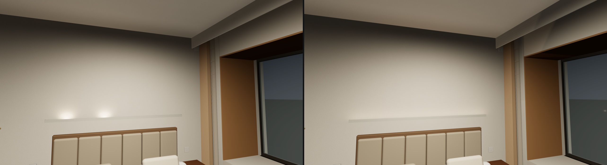
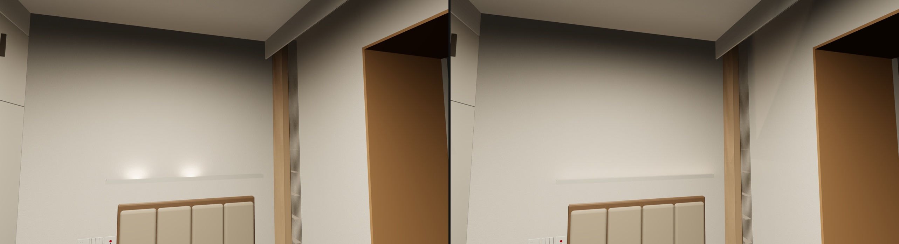

# 1601 两间卧室床头灯带洗墙

2026-11-21。正式实时 3D 以实际向上发光面为光源，沿长轴积分。主卧和次卧的灯槽外宽分别为 2000、1400 mm，实际发光面长 1997、1397 mm，底部离地 1250 mm。两条保持 3000 K 和 30% 预览亮度，各用两个带阴影的连续段覆盖全长。保留原发光矩形、灯具实体和保存字段。

## 同机位夜景

每张对照图左为 `b7ff27c1`，右为本次改动。两间以 1660 mm 眼高重新构图，水平视角 84°。截图与手势分别使用 [固定机位](rooms.json)。同一份正式 1601 的隔离副本使用 21:00 太阳时（保留 2026-07-19、纬度 38° 的场景设置）、主灯开、低位夜灯关，临时显示「灯」图层。两态固定实际 ACES 曝光 10，GTAO、Bloom、SMAA、光追均关闭。





以原生 2840 × 1554 PNG 的 8 位亮度取样。沿床头灯带上方、避开端部的 43 个小窗，比较同画面的灯带启闭差值。表中峰谷以 P95 和 P05 表示。两间均压低原点光峰值，抬起段间暗隙。顶面适度提亮，墙顶暗部仍明显，近看可见原乳胶漆细颗粒。床头板与窗帘盒的边缘和材质各自可辨。

| 房间 | 灯带亮度贡献 P05–P95 | 顶面取样均值 | 墙顶转角暗部均值 |
| --- | --- | --- | --- |
| 主卧 | 0.0–40.8 → 10.6–15.5 | 116.3 → 122.5 | 38.0 → 36.5 |
| 次卧 | 0.1–37.2 → 10.3–16.8 | 107.8 → 109.6 | 41.6 → 41.7 |

取样使用截图 RGB 的 0.2126、0.7152、0.0722 加权值。换算到 1200 × 656 的画幅坐标，主卧采样线从 (176, 460) 到 (722, 440)，次卧从 (283, 468) 到 (706, 454)，沿线取 8% 到 92%。每点取 7 × 5 小窗均值。顶面取样矩形两角分别为主卧 (400, 25)、(650, 65) 与次卧 (380, 28)、(650, 62)。暗部取样矩形两角分别为主卧 (472, 143)、(580, 155) 与次卧 (430, 120)、(590, 136)。

在隔离副本分别将单条亮度设为 0、关闭主灯、把单条灯带分到临时隐藏图层。三种状态均关闭该灯带的实际发光与实时段。单独调零或隐藏时，其余已开启灯具仍照明。复原开关后加一块只参与投影的测试挡片，两个场景均在墙面对应区域出现暗部。移除挡片后原生 PNG 逐字节恢复。真实挡边、墙、顶和家具沿生产阴影图投影。每段用中心阴影图近似可见区，紧贴或跨越两段的复杂遮挡仍可能有段边差异。手势期间沿用既有缓存，松手后补齐阴影。灯带多于可用阴影位时，超额段暂停实时出光。

## M6 实测

正式快捷方式对应的 Electron 包，ANGLE Metal Apple M6。每轮从同一 248 件家具的正式方案创建隔离副本，流畅观察原生画布 2840 × 1554、DPR 2，夜景拖动期间回到既有的 1.25。按改前、改后、改后、改前执行。沿上轮机位和同一组真实指针轨迹旋转、平移并拖床，逐轮松手撤销并核对原位置。手势机位的静态绘制调用数各态一致，主卧 350，次卧 581。

每格列出改前两轮 → 改后两轮，单位 ms。绘制间隔取实际渲染调用起点之间的时间。有效输入到提交从确实产生新位姿的指针事件起算，截止对应 WebGL 提交。

| 房间 | 旋转绘制间隔 P50 | 旋转绘制间隔 P95 | 平移绘制间隔 P50 | 拖床绘制间隔 P50 | 有效输入到提交 P95 |
| --- | --- | --- | --- | --- | --- |
| 主卧 | 16.5 / 16.4 → 16.6 / 16.6 | 25.5 / 55.8 → 20.6 / 49.0 | 16.7 / 16.6 → 16.7 / 16.7 | 31.4 / 31.8 → 32.1 / 31.4 | 31.1 / 32.2 → 31.7 / 31.7 |
| 次卧 | 16.7 / 16.7 → 16.7 / 16.6 | 17.6 / 17.8 → 24.7 / 18.2 | 16.6 / 16.7 → 16.7 / 16.7 | 35.0 / 35.2 → 35.3 / 34.5 | 32.4 / 33.1 → 32.8 / 32.6 |

主卧旋转仍出现约 128–130 ms 的最长绘制间隔。次卧有一轮改后旋转出现 245.6 ms 的长帧。每轮实际床位更新次数为主卧 45、次卧 21。次卧拖床最长绘制间隔约 765–766 ms，四轮均在同一路段出现。该区间每轮 23 次吸附计算仅 1 次产生新位置。输入延迟未测显示器出光时间。

## 复现与留证

```sh
FURNISH_DESKTOP_EXE="$HOME/Applications/Furnish.app/Contents/MacOS/Electron" \
FURNISH_RASTER_ROUND=bedside-wash \
FURNISH_RASTER_ROOMS=docs/validation/1601-bedside-wash-20261121/rooms.json \
node scripts/verify/verify-living-furniture-raster.cjs /path/to/workspace.furnish.json b7ff27c1
```

原生 PNG、关闭和遮挡对照、逐帧与逐事件数据见本机 `output/desktop-verification.noindex/room-raster-myzn1y.noindex/`。源码、资源副本和可再生成缓存按隔离任务登记清理，保留图、报告、日志和副本的持久存储。正式 1601 保存文件的 SHA-256、活动方案和 MCP revision 前后一致。

增量回归通过灯槽实体／实际发光面、镜像旋转、阴影预算与缓存、吊顶遮挡、灯光导出、乳胶漆局部光照、对象图层和后期着色模块检查。Chrome HTTP、断网 `file://` 和隔离 Electron 均在流畅观察验证灯具参数、撤销重做、保存刷新和生产导出的光源。该轮界面证据见 `output/desktop-verification/cove-light-M4XBie.noindex/`。未运行全量、窄屏和独立高清光追验收。
