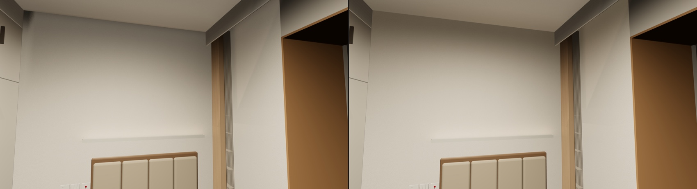
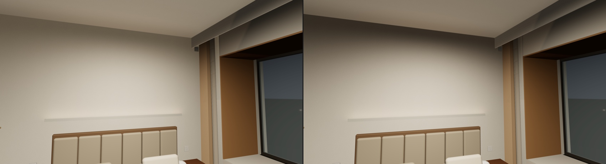

# 1601 墙顶接缝与地板回光复核

2026-11-22。基线 `f8903f61`。上一版的上墙回光在平面降顶范围内改用较低的顶面高度，并在靠近该高度时减弱，次卧衣柜边吊旁因高度切换出现一条狭长暗斑。外墙边采样也可能混到房间范围外的黑色纹素。

本次从各房间的基础顶高度给墙面生成宽缓的高度渐变，局部降顶边界由实际板件和直射阴影表达。回光场只将房间数值向没有归属的边界纹素外延最多约 85 mm，相邻房间内部继续使用各自的光源。床头灯带、灯具角度、阴影贴图和曝光沿已有生产设置。

地板回光在上一版已参与近似计算，但有效颜色有时只是材质的默认白色。本次使用生产地板完成面的基色。地砖读地砖材质已有的基色，旧木地板及其它程序纹理沿纹理底色。反射光的颜色和强度随该基色变化。测试中隐藏地板会撤去该房间地板对新增上部回光场的贡献，向上灯带及既有吊顶光仍可参与。该算法估算漫反射，光路的逐物体可见性和多次反弹仍受实时算法限制。

## 亮灯条件

正式方案只读记录显示「主灯」开关为开，「灯」图层隐藏。本次和上次同机位对照都在隔离副本临时显示该图层，21:00、低位夜灯关、实际 ACES 曝光 10。两版逐个读取了可见生产发光面，均有 16 组正发光，包含客厅 L90、餐桌 D30、两间卧室 D40、走廊及阳台 D20、厨房平板灯和卫生间浴霸照明。床头、阅读等辅助灯也按各自状态发光。米家吸顶灯、厨房平板灯和浴霸实时直射采用柔化的向下半球，半角 90°，近水平处衰减。筒灯产品规则的预览光束全角为 100°。

## 同机位与地板开关

次卧左侧衣柜边吊旁的竖向暗斑消失。沿同一上墙水平线采样，七个位置的 8 位加权亮度范围由 47.8–92.5 收敛到 82.1–83.3。次卧窗帘盒下沿和墙顶交线仍可辨。

主卧临时隐藏地板图层，其余照明设置固定。上墙取样由 98.0 到 54.8，顶面由 141.0 到 126.6，灯带附近的墙面为 204.5 到 204.4。以 830 × 454 的画幅为参照，次卧取样窗为 y40–52，x 从 58 起每隔 8 像素取 5 像素宽，共七窗。主卧上墙、顶面和灯带附近分别取 (330,102)–(401,113)、(304,23)–(400,44)、(370,288)–(450,303)。

## 范围和复现

M6 正式快捷方式对应的 Electron 隔离副本，ANGLE Metal WebGL，流畅观察，2840 × 1554。GTAO、Bloom、SMAA 和光追关闭。沿[上一轮九个机位](../1601-wall-ceiling-return-20261122/rooms.json)逐间复核，场景设置和绘制调用数前后一致。主卧、厨房的关灯和日景四对原生图各自逐字节一致。主卧各一轮手势中旋转绘制间隔 P50 均为 16.7 ms，P95 为 17.7 → 17.8 ms，床各有 45 次有效位姿更新并撤销复位。增量回归覆盖完成面颜色、隐藏地板和灯具、房间边界、灯带实体、吊顶遮挡、阴影缓存和后期模块。未运行全量及窄屏。

使用 `FURNISH_RASTER_ROUND=upper-edge FURNISH_RASTER_RUNS=before,after` 及上一轮 `FURNISH_RASTER_ROOMS` 运行 `scripts/verify/verify-living-furniture-raster.cjs`，参数为 1601 工作区路径及 `f8903f61`。原生图、发光面清单、逐帧结果保留在 `output/desktop-verification.noindex/room-raster-R9wPeu.noindex/`。隔离进程已关闭，可再生成源码和缓存按归属清理，证据、日志与隔离副本持久存储保留。
