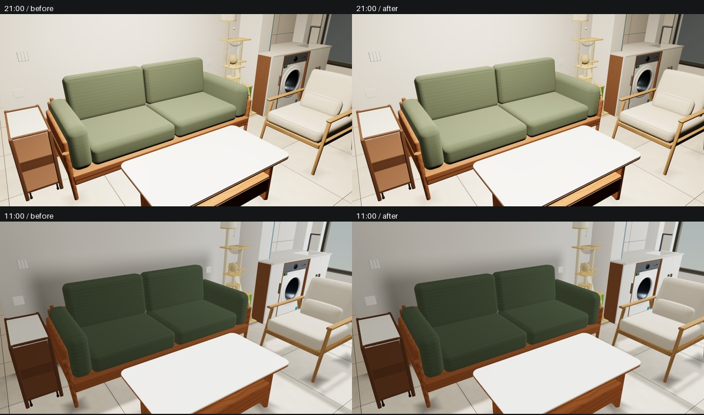
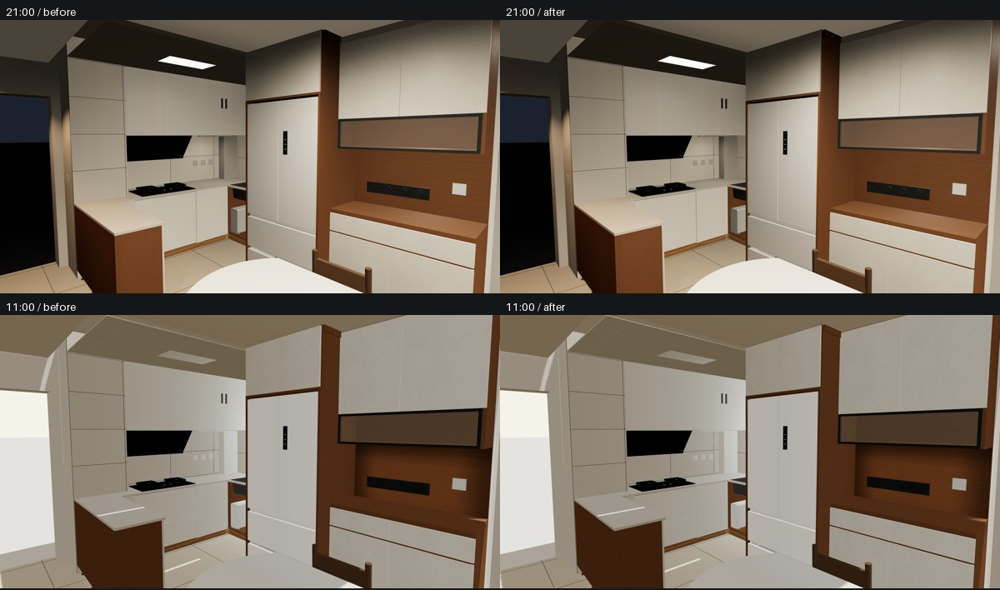
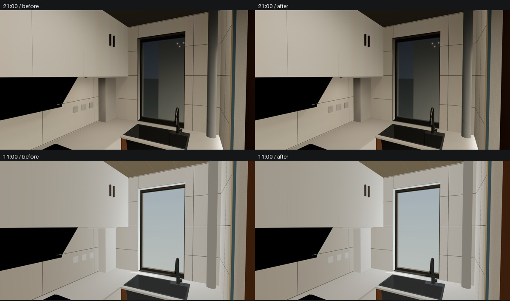

# 1601 木饰面、暖白门板和白岩板

2026-11-22。基线 `6f34168a`。借鉴 [Set the Mood](https://sael.net/interior/) 的同场景日夜比较方法。材料来自现有 1601 方案及 Furnish 生产模型，保持已选色与配色优先级。

| 饰面 | 范围及处理 |
| --- | --- |
| 木饰面 | 客餐厅内已带木饰面的柜体面，包括餐边柜。读取原木皮贴图与物理 UV，沿生产板件纹向。保留木皮颜色和细法线，轻调法线幅度与粗糙度，颜色微差沿原纹理坐标。 |
| 暖白哑光门板 | 1601 厨房内现有无贴图、非金属门板和抽面。保持已选暖白，通过门板局部 XY 以 115 mm 平铺微表面，做较宽的哑光反射。硬件、玻璃与石材沿各自反射。 |
| 白色岩板 | 客厅樱桃木茶几的白岩板生产面。局部 XZ 以 175 mm 平铺细矿物变化，带少量微法线和较宽反射。保持素白基色与原岩板厚度、倒角，纹理随米制坐标变化。 |

规格保存在实时表面配置中，适用部件由生产角色和材质识别。细纹共用离线生成的纹理与 mipmap，木皮复用本地材质资源。导出读取原生产材质，微表面为 Furnish 实时观察处理。数值属于外观标定。

## M6 增量验证

同一正式快捷方式 Electron 隔离副本，M6 ANGLE Metal，流畅观察 2840 × 1554。21:00 主灯开、低位夜灯关、临时显示灯层、ACES 曝光 10。11:00 主灯关、曝光 1.05。关闭 GTAO、Bloom、SMAA 与光追。三个机位眼高 1660 mm。日夜对照可见门板保留细微漫反射、白岩板仍以浅白为主。分色保持温和，表面的微小差别在原生截图上更容易辨认。

客厅、餐厅及厨房前后分别保持 2288、2098、1084 次绘制，三角形数量一致。茶几拖动两版均有 33 次有效位姿更新并撤销复位。客厅旋转绘制间隔 P95 18.8→17.7 ms，平移 18.7→18.4 ms，茶几有效输入至提交 P95 22.8→22.8 ms。两版拖动均有偶发长帧。正式源文件哈希一致。见 [逐项测量](measurements.json)。

Node 增量检查通过房间着色与采样方式、实际饰面覆盖优先级、厨房和柜体生产范围、旧项目／命名项目反复恢复、茶几生产外包和床品回归。未执行全量与窄屏。已知边界是强光下白岩板的差异仍偏轻，微表面纹理采用外观近似。

[机位](rooms.json) 配合 `FURNISH_RASTER_ROUND=finish-surfaces FURNISH_RASTER_RUNS=before,after` 复现。本机原生同机位、斜视与逐帧数据在 `output/desktop-verification.noindex/room-raster-MrWvdL.noindex/`。
