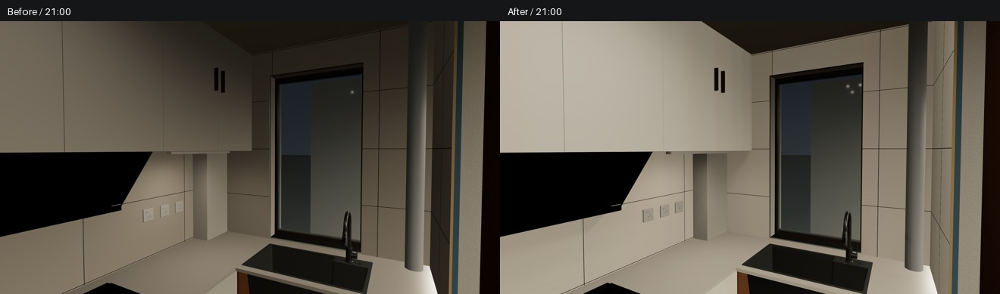
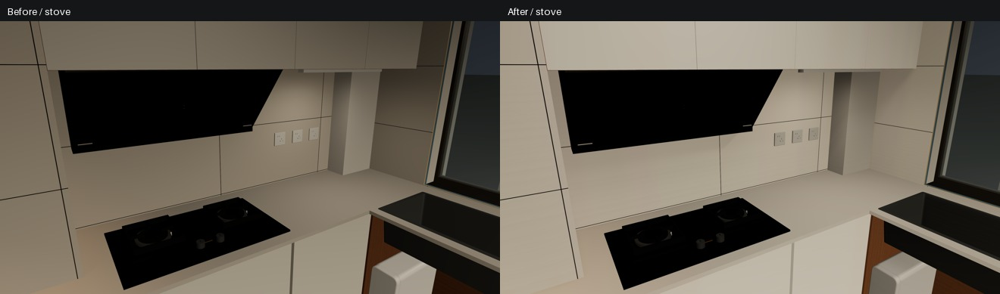
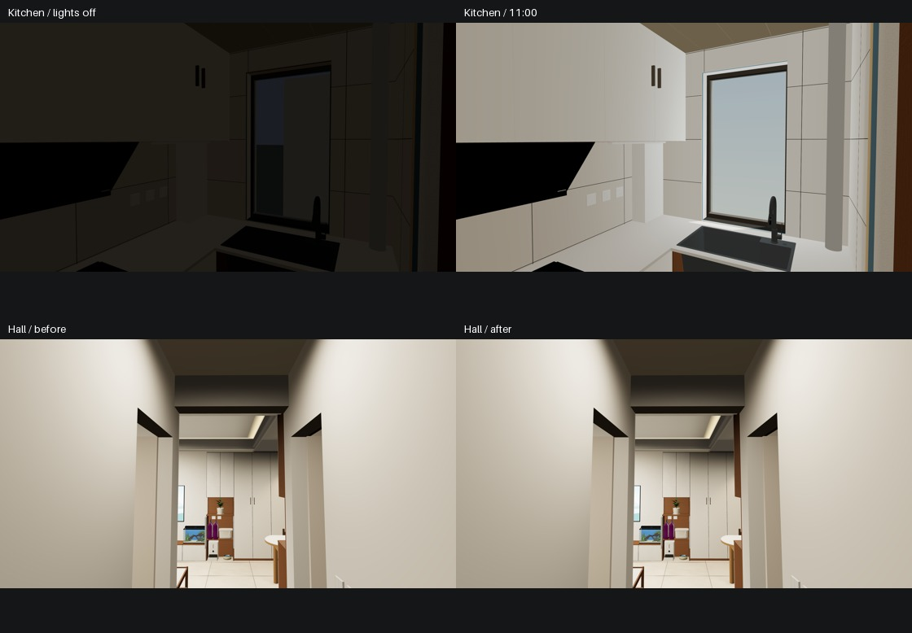
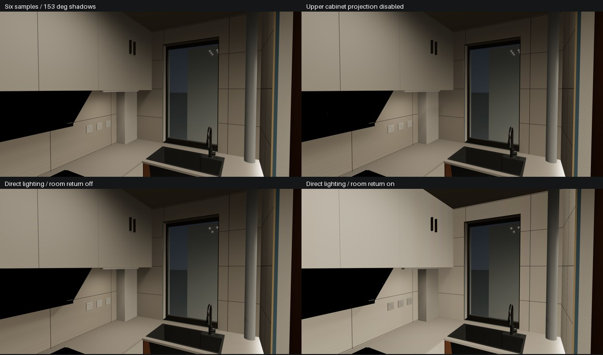

# 1601 厨房平板灯与柜底回光

对照基线 `5f89981f`。正式 1601 为方案34电气布点，MCP 只读看到主灯开、低位夜灯关、「灯」图层隐藏。截图在同一正式快捷方式对应的 Electron 隔离副本临时显示灯层并设为 21:00。同一张图的镜头、眼高 1660 mm、ACES 曝光 10 全部固定。关灯对照沿用夜景曝光，日景 11:00 使用原日景曝光 1.05。源文件 SHA-256 在验证前后相同。

## 实际光源和遮挡

- 平板灯的生产发光面为 294 × 594 mm，可见发光色 `#fff4e4`，发光面绝对高约 2477 mm。原实时预算送入两份直射样本，共 20 cd 展示权重，只有一份有阴影贴图，贴图的相机角为 180°。保留向下的全半球衰减，把阴影视锥单独设为 153°。进厨房后，全屋 6 张阴影贴图预算中使用 4 张积分矩形面光，合计 60 cd 展示权重，1 张给厨房内的备餐灯，1 张给原候选。有限视锥内可重建吊柜和墙边的遮挡。有限视锥外仍用原直射光衰减。
- 备餐台柜底灯的记录为规划占位，生产发光面为 590 × 30 mm，绝对高约 1634 mm，颜色 `#fff1dc`，展示权重 15 cd。沿实际开启及图层状态参与绘制。平板灯原有两束向上预览回光仍参与全屋候选，在本次厨房机位未分到灯光预算。
- 烟机深色玻璃保留 JCD10TA 生产材质 `#101214`。临时只调浅玻璃显示了玻璃自己的边界和控制件。关闭吊柜投影的试验显示柜底实体造成的遮蔽仍独立存在。保留生产遮挡，沿既有 1601 房间回光纹理把可见灯具的漫反射分配到厨房墙砖、柜体及台面。离开厨房时沿原全屋预算。
- 左上柜门、窗边墙砖、水槽旁台面与灶台侧下墙砖的同机位 8 位加权 RGB 均值分别为 89.3→180.3、40.2→92.6、126.2→156.1、129.4→158.5。柜底残留阴影和台面边仍可辨。取样框为原图的归一化 `(x0,y0,x1,y1)`，分别为 `(.19,.17,.23,.22)`、`(.72,.25,.748,.32)`、`(.416,.845,.444,.882)`、`(.26,.705,.298,.758)`。

将同样六份样本的阴影视锥从 180° 改到 153° 后，557881 个像素至少有一个通道变化超过 2。保持 153° 后，撤掉吊柜投影影响 263670 个像素，单独撤掉烟机投影在这一视角没有可见变化。临时仅调浅烟机玻璃影响 284944 个像素，变化集中在黑玻璃本体。保持最终直射样本并关闭厨房回光时，四处表面均值分别是 143.7、49.8、136.4、129.4，说明窗侧墙砖和灶台侧下墙仍需实际可见光源驱动的间接照明。消融原图保存在 `output/desktop-verification.noindex/room-raster-wRV1Rd.noindex/`。

## M6 与兼容性

流畅观察，ANGLE Metal WebGL，原生 2840 × 1554，关闭 GTAO、Bloom、SMAA 和光追。厨房静态维持 1084 次绘制调用及 224684 个三角形。走廊开灯、关灯、日景的原生图分别逐字节一致。厨房关灯逐字节一致，日景 RGB 通道最大差为 1 个 8 位单位。

| 同轨迹手势 | 绘制间隔 P50，改前 → 改后 | P95，改前 → 改后 |
| --- | ---: | ---: |
| 厨房旋转 | 16.7 → 16.6 ms | 18.0 → 18.8 ms |
| 厨房平移 | 16.6 → 16.7 ms | 18.3 → 18.6 ms |
| 主卧床拖动 | 32.9 → 32.5 ms | 164.5 → 165.1 ms |

主卧床每轮均有 45 次有效位姿更新，隔离副本中均已撤销复位。厨房推车被遮挡，吊柜测试轨迹未产生有效位移，家具样本改用可拾取的主卧床。拖动 P95 仍受原场景拖动开销限制。

本轮增量 Node 检查覆盖成品灯体与扣板开口、旋转／镜像及旧项目回读、局部阴影预算和缓存、灯具可见性、回光房间边界及烟机几何／项目回读。无新增网络资产、项目字段或安装尺寸。未运行全量和窄屏测试。补光是基于发光面、现有完成面与接收方向的实时漫反射近似。模型无厂家灯具光强分布，低资源预算使用单个带阴影的中央行样本，窗玻璃上可能看到离散的采样高光。数值仅用于预览对照。

以 [rooms.json](rooms.json) 为 `FURNISH_RASTER_ROOMS`，设置 `FURNISH_RASTER_ROUND=kitchen-light FURNISH_RASTER_RUNS=before,after`，运行 `scripts/verify/verify-living-furniture-raster.cjs <1601 工作区文件> 5f89981f`。 [精简测量记录](measurements.json) 和本目录缩图随提交保留。原生图、逐帧测量与隔离持久存储在本机 `output/desktop-verification.noindex/room-raster-D1LiY6.noindex/`。验证进程结束后已清理登记的可再生成源码和缓存。
