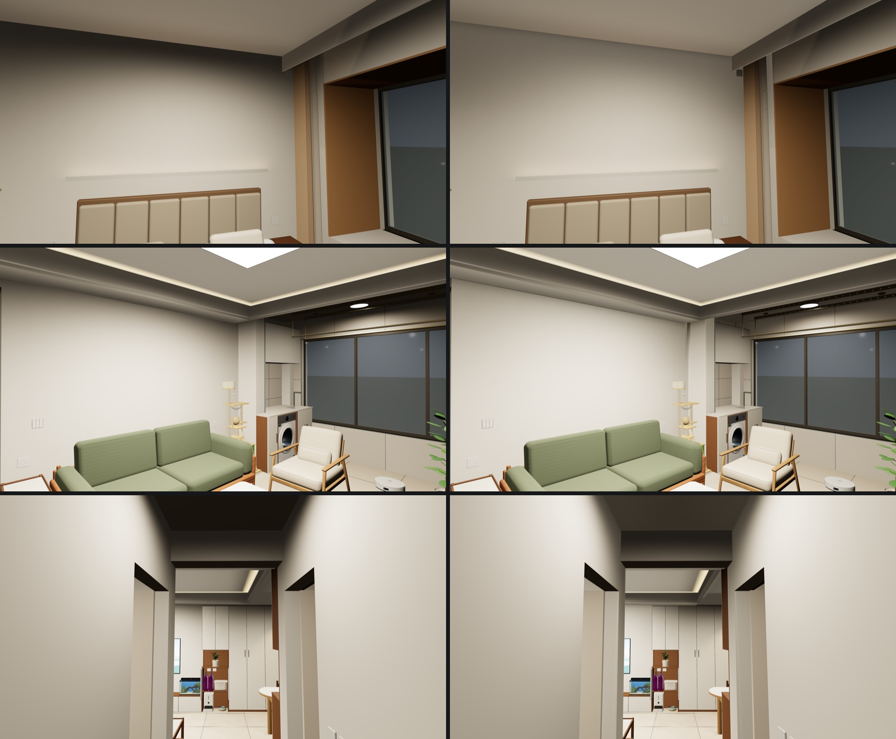
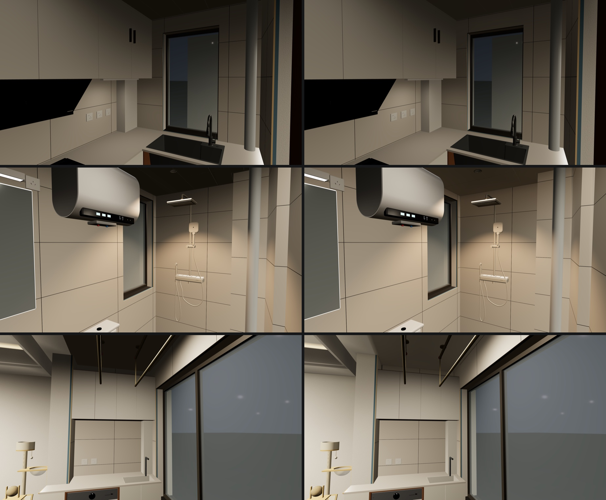

# 1601 墙顶交界夜景回光

2026-11-22。基线 `3913e9a7`。沿正式实时 3D 的夜景材质通路，在 1601 增加按房间计算的上部漫反射。补光来自实际启用且可见的发光面。向下灯具使用地面基色和局部距离衰减，向上床头灯带沿实际发光长度计算局部回光，已通过几何遮挡检查的吊顶灯槽继续提供回光。

新回光图沿房间范围约束能量，避免原地面回光在距墙约 0.52 m 内的衰减直接形成上墙暗带。上墙从实际基础顶和较宽平面吊顶的高度向下渐弱，近交界保留阴影。顶面只对朝下的表面增加漫反射，沿用乳胶漆、铝扣板和墙砖的各自颜色与材质。梁和窄窗帘盒前挡仍由几何和既有阴影表现。地面回光、柜侧间接反射保留原适用范围。关闭主灯或隐藏发光面后停止其贡献。

新增回光场沿实际场景和光源状态失效，镜头移动复用已有贴图。每个接收表面仅增加材质取样，沿原 WebGL 绘制，不改变灯具强度、曝光、持久字段或独立高清导出。该算法是室内相邻表面的局部漫反射近似，完整多次反弹、隔门散射和间接光的逐物体遮挡仍受实时算法限制。

## 同机位对照

正式快捷方式对应的 Electron 包，ANGLE Metal Apple M6，隔离副本使用同一份 1601。固定 21:00、主灯开、低位夜灯关、曝光 10，临时显示「灯」图层。流畅观察关闭 GTAO、Bloom、SMAA 和光追，画布 2840 × 1554。各机位见 [rooms.json](rooms.json)。

两组图均为左改前、右改后。第一组从上到下是主卧、客厅、走廊。第二组是厨房、卫生间、阳台。另检查次卧、餐厅和玄关的原生图。





同位置像素窗的 8 位 sRGB 加权均值如下。这些值描述画面亮度。

| 选区 | 改前 | 改后 |
| --- | ---: | ---: |
| 主卧墙顶交界下方 | 36.9 | 107.5 |
| 次卧墙顶交界下方 | 42.1 | 104.1 |
| 客厅吊顶下方上墙 | 97.2 | 142.8 |
| 厨房窗上方墙砖 | 27.1 | 35.5 |
| 卫生间铝扣顶 | 15.2 | 36.8 |
| 走廊顶面 | 19.6 | 48.7 |
| 走廊横梁立面暗部 | 37.8 | 37.8 |
| 阳台顶面 | 18.6 | 45.6 |

主卧日景像素一致。主灯关闭的主卧有 5 个像素变化 1 级。厨房日景和关灯夜景各只有相同位置的 2 个像素有差异，最大单通道差分别为 21 和 6 级。其余像素一致。固定机位的绘制调用与三角形数量在九个空间前后相同。

主卧补测一次改前和一次改后手势。沿上一轮轨迹，旋转绘制间隔 P50 同为 16.6 ms，P95 为 18.1 → 17.9 ms。平移 P95 为 18.5 → 17.9 ms。拖床各有 45 次有效更新，有效输入至 WebGL 提交 P95 为 32.3 → 32.7 ms，松手后撤销复位。这是局部核对，样本为每态一轮。

## 复现与范围

```sh
FURNISH_DESKTOP_EXE="$HOME/Applications/Furnish.app/Contents/MacOS/Electron" \
FURNISH_RASTER_ROUND=upper-return FURNISH_RASTER_RUNS=before,after \
FURNISH_RASTER_ROOMS=docs/validation/1601-wall-ceiling-return-20261122/rooms.json \
node scripts/verify/verify-living-furniture-raster.cjs /path/to/workspace.furnish.json 3913e9a7
```

原生图、场景参数和逐帧数据保存在本机 `output/desktop-verification.noindex/` 的 `room-raster-33rHBz.noindex/`（改前）和 `room-raster-qV3x8V.noindex/`（最终改后）。初次逐字节控制断言遇到少数像素差异后停止，随后用最终改后版本补完九个机位，并逐像素核对四张控制图。隔离进程已退出，可再生成的源码与缓存已按归属清理，保留原生图片、日志和副本的持久存储。正式 1601 文件的 SHA-256 一致。

增量回归覆盖乳胶漆及铝扣板着色、真实降顶高度、相邻无灯区域、隐藏灯具、向上灯带长度、阴影缓存、吊顶遮挡及后期着色模块。未执行全量、窄屏或光追验收。
