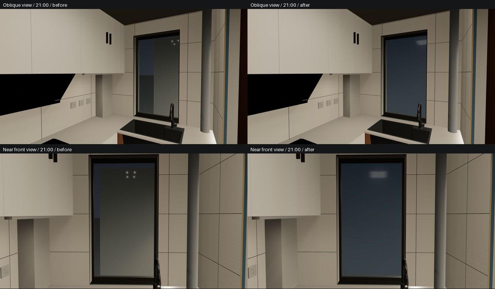
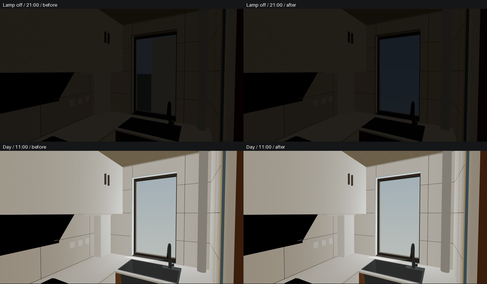

# 1601 窗玻璃夜空和随视角的灯具反射

2026-11-22。基线 `1b35da62`。厨房窗在两角度都能看到来自平板灯实时采样的多个亮点。本轮复用已登记窗洞的渐层背景，沿已记录的展示灯色。夜景采用连续的暗蓝渐层。玻璃按掠射角提高反射权重，并将厨房平板灯的可见生产发光矩形投影到玻璃反射方向。斜视时亮斑移到右角，接近正视时向窗中移动。柔化边缘来自有限宽的反射近似。

室内主灯关闭后矩形反射消失，夜空仍可见。11:00 日景控制图前后逐字节一致。复用当前窗洞、透明玻璃材质及拾取身份，夜空与反射仅用于实时主画布。夜空为程序化渐层，矩形反射读取已显示且发光的厨房灯具，未模拟其它物体的镜像、外部街景和逐物体反射遮挡。

## M6 与兼容验证

同一正式快捷方式 Electron 隔离副本，Apple M6 ANGLE Metal，流畅观察 2840 × 1554。保持眼高 1660 mm，灯层按测试显示，21:00 夜景曝光 10，11:00 日景曝光 1.05。GTAO、Bloom、SMAA 和光追关闭。厨房原生帧绘制数 1084→1085，客厅 2288→2290，夜景启用了窗外背景平面。

| 同轨迹手势 | P95 改前 → 改后 |
| --- | ---: |
| 厨房旋转绘制间隔 | 18.5 → 17.8 ms |
| 厨房平移绘制间隔 | 18.7 → 18.7 ms |
| 客厅茶几有效拖动输入至提交 | 22.8 → 22.3 ms |

茶几前后均有 33 次有效位姿更新，测量后撤销。客厅平移的单帧最大值由 33.1 到 48.3 ms，P95 由 18.6 到 18.4 ms。本次样本为单组 A/B。正式工作区哈希一致。增量 Node 检查覆盖窗洞保存、玻璃材质和拾取、夜空独立于室内主灯、反射光源随开关及可见性消失和阴影缓存。未执行全量与窄屏界面验收。

最终源码通过隔离 Chrome 的本地 HTTP 和断网 `file://` 冒烟验证，覆盖 3D、撤销重做及缓存刷新。另以正式 1601 的当前布置打包仅含活动方案的项目副本，用文件选择器导入断网 Chrome，实际渲染 248 件家具的厨房，外网请求为 0。证据保留在 `output/desktop-verification.noindex/offline-1601-BcicJ4.noindex/`。

[机位](rooms.json) 配合 `FURNISH_RASTER_ROUND=window-glass FURNISH_RASTER_RUNS=before,after` 复现。[测量](measurements.json) 随提交保留，原生图、逐帧数据、隔离方案和持久存储在 `output/desktop-verification.noindex/room-raster-AHbcxJ.noindex/`。登记的可再生成源码和图形缓存已按归属清理。
