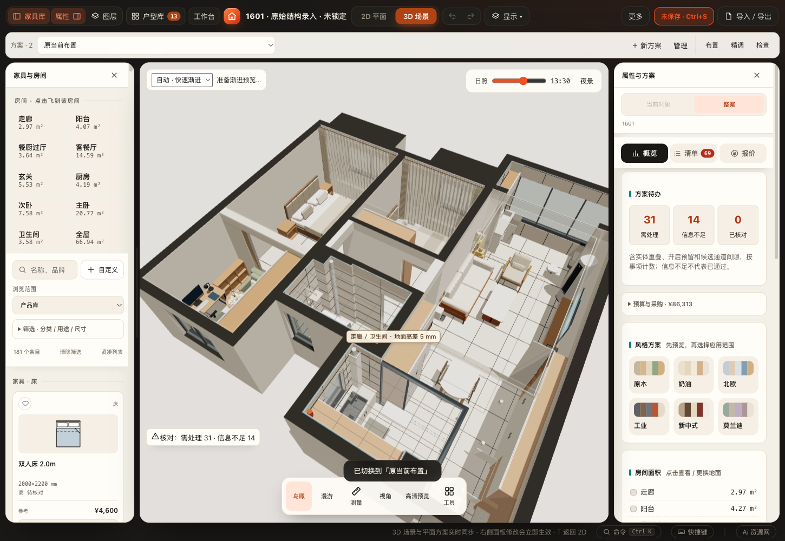
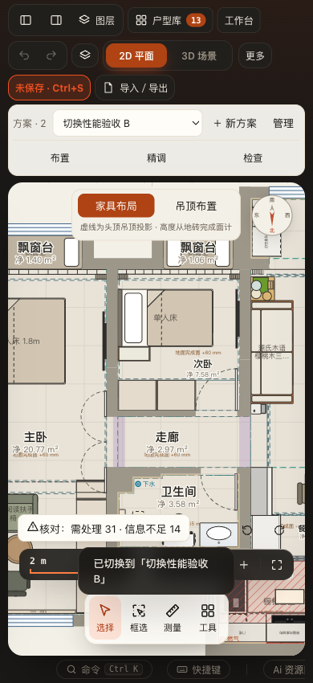

# 方案切换性能与选择框同步

2026-11-17，macOS arm64，同一本机 Furnish 打包 Electron，在隔离工作目录、端口及配置中复制正式方案验证，原方案文件散列在各轮前后保持一致。测试副本与应用生命周期沿 test-artifacts 自动清理，可再生成代码／资产已清除，方案、浏览器持久存储及证据保留。正式窗口只读检查连接及保存状态，没有在正式窗口切换或覆盖方案。

## 原因与改动

- 旧 onchange 先将 select 设回旧 ID，后续保存、派生及重绘才重建控件选中目标；切换中显示旧方案，且销毁原生控件可能干扰 macOS 菜单关闭。现在保留控件直接同步活动值，拒绝切换则恢复真实值。
- 旧切换保存整个工作区两次，且即使已有活动方案仍先恢复当前工作副本。现在只同步离开方案的独立记录，一次保存最终工作区；无绑定布置仍保留独立方案及恢复点。
- 自定义户型恢复时先 replan，renderAll 再 sync，切换末尾再次 replan。现在该切换重绘汇总为一次场景重建；普通编辑默认路径保持。

## 对照计时

从设置选中值并派发 change，到同步事件处理返回；包含恢复／校验、恢复点、缓存保存、二维／属性绘制及主三维构造。**不包含正式磁盘 flush、GPU 绘制完成或渐进光追收敛**。两轮均复制本机正式文件，仅方案备注不同，短样本用来验证减少重复工作，不代表所有数据与硬件的性能保证。

| 模式 | 改前 | 改后 | 变化 |
| --- | ---: | ---: | ---: |
| 二维，4次均值 | 243.2 ms | 132.2 ms | 约减少46% |
| 三维，2次均值 | 638.3 ms | 292.2 ms | 约减少54% |
| 390px窄屏，1次 | 288.7 ms | 142.1 ms | 约减少51% |

每次完整工作区 save 2→1，View3D.replan 2→1；重复选择时 select 节点由替换变为保留。原始测量数值见 [timings.json](timings.json)，精确值以记录为准。

## 已通过

- `node tests/test-design-switch-performance-ui.cjs`：HTTP、断网 file://、同一打包桌面三入口；2D、3D、390px窄屏；往返／连续选择、显示 ID 与活动 ID 一致、切换拒绝恢复、编辑独立性、撤销重做、恢复点、清空跨方案撤销栈。桌面正式保存副本后重载恢复活动方案及备注。
- `node tests/test-design-switch-performance-ui.cjs --desktop-only`：额外覆盖未绑定当前布置首次切换时独立保留，原目标记录不被覆盖。
- `node tests/test-mcp-design-switch-ui.cjs`：既有桌面 MCP 切换、重试幂等、过期修订、非法目标／活动编辑拒绝、独立保存及刷新、保存失败 applied:true/persisted:false 回执。
- `test-design-switching`、`test-autosave`、`test-recovery-storage`、`test-canvas-render-cache`、`test-project-recovery` 通过；三份生产 JS 及新测试语法通过。
- 实际打开检查下方两张桌面截图：三维正常显示原生产场景及对应方案名称；窄屏目标名称完整可辨、选择框与方案一致。

## 范围

未执行全量检查、Windows 原生菜单实机或所有历史方案遍历。自动化验证真实 select 的选择及 DOM 保留，未将 macOS 原生弹出菜单关闭过程录制为视频。大型方案同步校验／绘制与光追重新收敛仍有开销，未引入预载多套场景或更多常驻内存。

原始运行证据：`output/desktop-verification/design-switch-performance-rDy9cg.noindex`（基线）、`design-switch-performance-eXBvM5.noindex`（首轮优化）、`design-switch-performance-iSdJEV.noindex`（三入口）、`mcp-design-switch-SOnFXG.noindex`（既有 MCP）。

补充分支最终通过证据：`output/desktop-verification/design-switch-performance-Nt5ZVu.noindex`。首次补验将“无绑定时新增方案选项”误判为也必须保留控件，断言失败；改为仅在选项列表不变的常规切换要求保留节点后通过，生产代码未因此改动。
