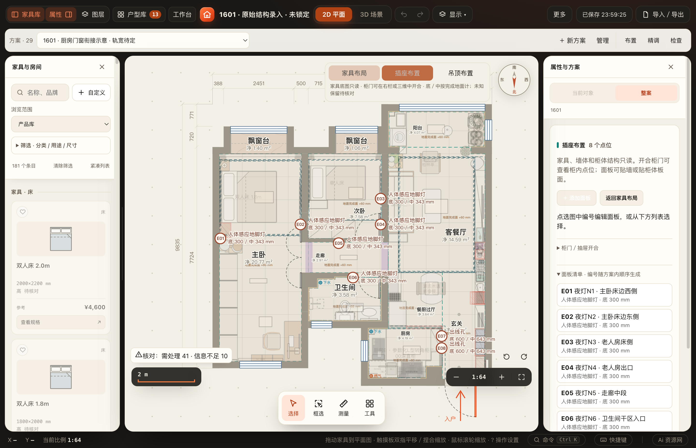

# 插座布置视图专项验收

2026-11-17晚至11-18凌晨。契约见[插座布置](../../ELECTRICAL-PLANNING.md)。

## 已通过

- `test-electrical-planning`：布局保护、组件柜开合例外，真实板面内外两侧，0／37／90度及镜像，面板完整高度和等于／低于宽度边界，贴面接触不穿板，跨区域完成地面及未知标高缓存失效，项目往返及重复恢复。
- `test-product-rules`、`test-work-state`、`test-cabinet-builder`、`test-drawing-export`；入口普通脚本联合声明、修改脚本语法及`git diff --check`。
- [同包桌面结果](desktop-results.json)：正式macOS包、独立源码／缓存／端口／1601项目副本。整份work在切换视图时不变；真实鼠标拖动／新增只影响面板；面板高度、原撤销重做、直接变更拒绝／回滚、仅选面板、柜门开合、实际侧板定位、撤销越过家具变更时停止、保存刷新、390px、原3D逐门扇回调、HTTP及断网file入口正常。无页面脚本异常。
- [最终浏览器检查](final-results.json)：本机Chrome、独立file来源配置；按钮文字／背景可区分，选择面板无普通家具缩放手柄，成果SVG保留编号及定位尺寸，面板自有锁定有效，三维展示偏好仍可修改，退出视图不改work；不带原editable参数的直接commit也回滚家具位移。
- 正式1601数据只读回放：6个组件／转角柜整体开启、3个厨房／洗衣组合模块逐扇开启均能通过电气保护，没有修改原文件。

正式文件验收前后SHA256均为`0aec9dae4aee75e99f19585cd3433be105d8465920b5766c46b67b5f8ed77113`。没有刷新或调整用户正式窗口。切换前已有8个面板，示意图中没有替用户新增插座。

## 环境失败与清理

首次受限环境启动因回环端口权限失败；随后使用允许的隔离桌面启动。第二轮脚本未展开柜门表单导致可见性等待，已修正。第三轮到3D通过后，系统缺少Playwright捆绑浏览器，file验收改用本机已有Chrome后通过；这属于验收工具环境，不把失败轮次计作通过。

正常结束的测试均通过test-artifacts归属接口清理再生成源码、vendor和图形缓存，保留方案、浏览器持久存储、截图和报告。已知失败轮次的浏览器遗留Singleton链接在确认测试进程退出后仅解除链接，再沿归属接口完成清理。首次异常中断的`output/desktop-verification.noindex/electrical-R60PnS.noindex`保留运行标记及现场，不扫描或清理其他任务的目录。

## 未执行与边界

没有运行全量check、Windows实机和物理电气施工核验。三维柜门保留原生产交互，专项调用实际逐扇回调，未逐一鼠标命中1601全部门扇。首版不包含底盒／柜板开孔、电路、插头拔插及检修可达性判断；后续柜体位移不带动面板。E编号按面板数组顺序派生，删除或重排会重新编号。
