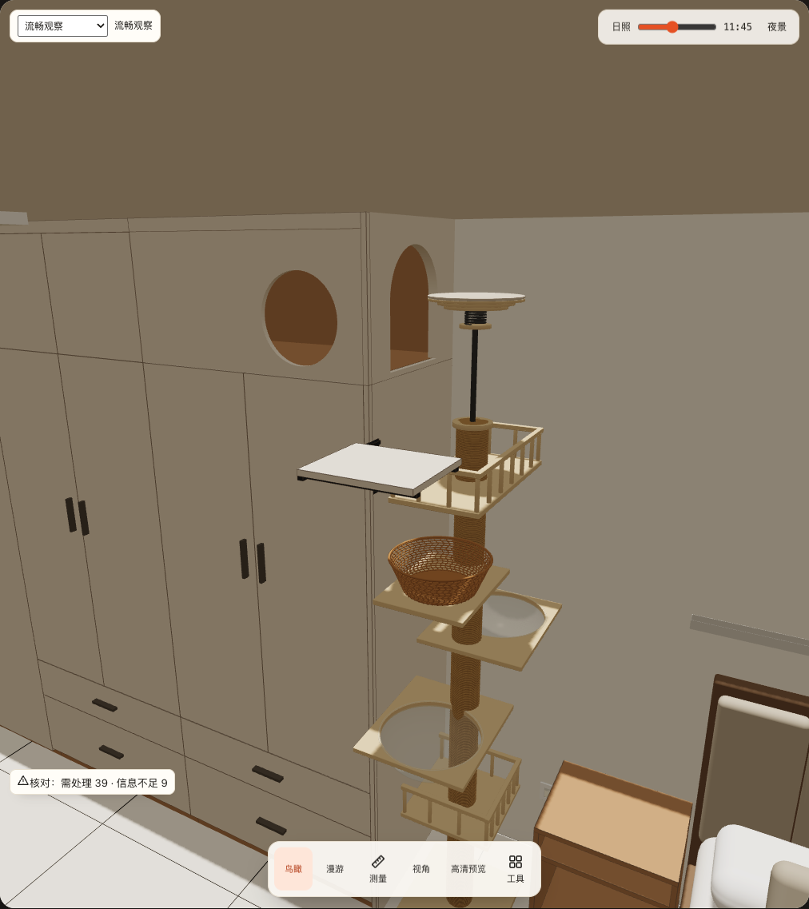
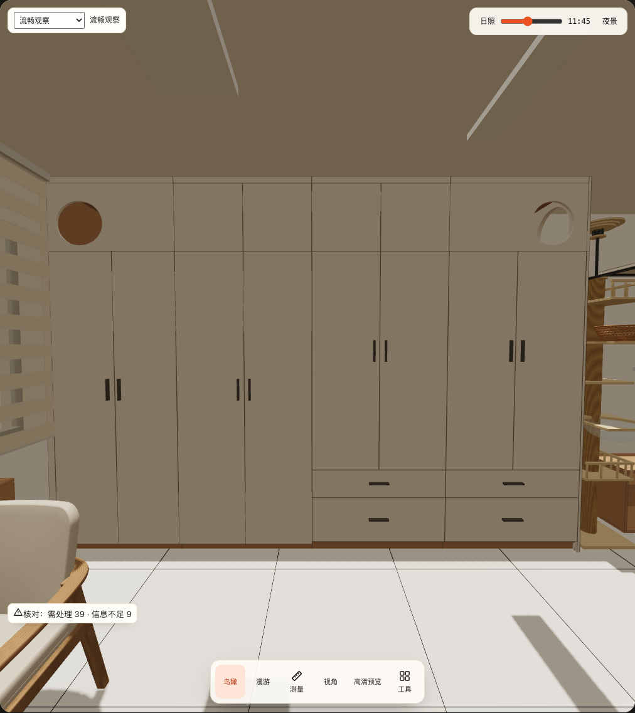

# 1601主卧：四个上柜、连续同色拱口与见光板

2026-11-18。按用户四项修改，直接通过Furnish MCP调整当前`dmwlmim9w`方案，家具`fmvvt0mto1`。应用来自`~/Applications/Furnish.app`，工作目录为本仓库；正式保存仍在用户的`Documents/FurnishData/1601/workspace.furnish.json`，未直接编辑该文件。

## 实际设计

- 四下柜分别叠四上柜，宽871／950／950／950mm；上下接缝、侧板位置对齐，独立柜箱相接保留双18mm侧板。每个上柜一组对开门，共八扇，各有结构侧板支撑铰链。
- 左封板100→50mm，第一柜箱821→871mm；主体外宽仍3789＝50＋871＋950×3＋18mm，整组带中转踏板4139×1010×2640mm。外包和其余柜箱世界位置保留。
- 下柜2134，上柜506，其中顶部收口20、顶底各18；猫道净高450，廊面2152、顶板底2602mm。内部净深594mm。
- 南侧新增18mm门板同色见光板：下段2134mm、上段506mm，接缝对应柜箱。见光板与18mm结构侧板分别表达，前端与现有18mm收口相接，无重叠面或右侧突出。
- 南侧入口及内部连通拱口净宽350、高400mm。每块侧拱板是连续挤出几何；南端见光板也有贯穿孔，同色、无黑色附框及分段描边。曲线采用96段近似，段数属于本案观察尺度，非产品默认值。模型没有表达加工倒圆半径；成品仍需同色封边、孔边倒钝。
- 侧孔沿深度居中，前部保留122mm实板供铰链底座；中后部洞口在相邻两侧板上重合。南入口较前版向柜后移85mm，仍落在原爬架最高平台投影内。原中转踏板、四只明抽及1650mm挂杆保留。
- 所有其它家具，包括窗帘/斑马帘，语义数据逐项比较保持一致。

见[Blum官方资料与本案应用](../../references/BLUM-CAT-WARDROBE-20261118.md)。[本轮柜体配置](wardrobe.json)仅作可复核证据，正式方案仍由应用保存。

## 验证及边界

通过：新侧向轮廓的真实Three连续面板、孔洞和描边；生产数值板件在孔中/拱顶上下的高度裁剪；旋转/镜像/离地；宽深高调整、捕获；v95当前/命名方案/家具库项目往返及恢复；原44个开闭模板生产几何/材质等价；板厚264项、既有外边界缩放、门抽开洞扫掠、项目20项、仓库/缓存兼容回归。新板件只支持静态多边形，拒绝未知轴、圆弧命令及活动侧向板件；旧XY及水平挤出保持原语义。未执行全量检查。

正式生产GLB导出97665352字节，核对本柜324个稳定生产部件身份；侧见光板各为真实18mm板件。读取导出三角面，入口中心200/417mm处为空、450mm处和后侧条有材料，不以整体包围盒代替孔洞确认。结果见[生产记录](production-check.json)。桌面已目视核对同色侧面、连续拱口与四组门分缝。

专项空间核对仍有三条：北端下柜门与上柜门各与斑马帘开启相交，以及原有800mm正面使用空间提示。保留50mm封板与窗帘原位，未擅自加宽或确认通过。铰链具体选型、实重/数量、侧孔加固、踏板连接承载、实际猫双向试走及北端观察孔防护均待深化；软件几何通过不代表施工承载或猫试走通过。
