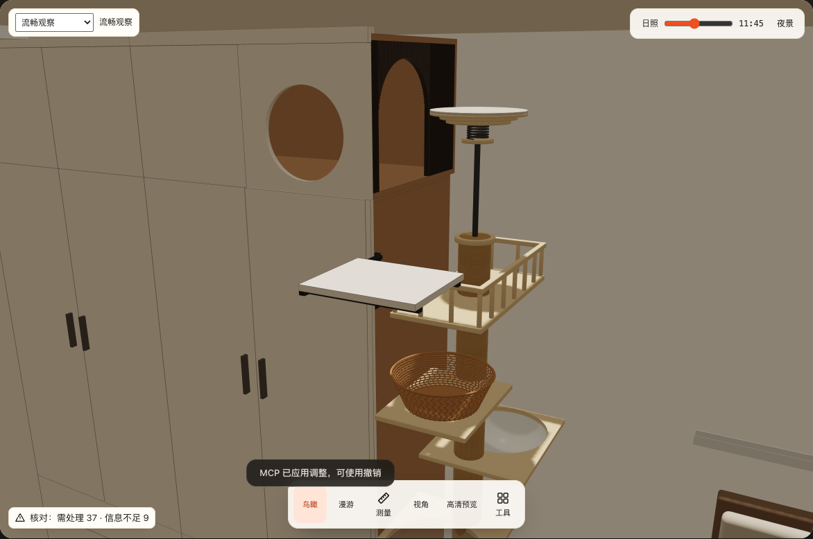

# 主卧猫柜侧拱入口与中转踏板
2026-11-18，1601副本 **主卧侧拱入口与中转踏板**（dmwlmim9w），原封闭猫柜方案保留。正式MCP保存回执persisted:true；四下柜及其他家具（含窗帘、猫爬架）不变。

猫爬架最高真实平台顶约1809mm，原平台前沿到柜侧约104mm；原正面猫洞下沿2174mm，比最高平台高365mm，侧向绕行后钻正面孔不作为顺畅路线。现按用户确认增加：

- 同一组件柜侧端拱口，约净宽350、净高400mm，下沿与猫廊地板2152mm齐平，猫廊净高450mm保持。
- 中转踏板350×300mm，板面顶1970mm；与原最高平台错开，世界平面X1549.5–1849.5、Y5442–5792mm。
- 路线约1809→1970→2152mm，上升约161／182mm；出柜按反向。仍需短跳和跨原平台侧栏，不称为无跳跃步道或已通过猫实际试走。
- 踏板、托架、拱框与原柜同属一个组件树。主体保持3789×630，加入外伸踏板后整组包络4139×1010；锚点随组合外包换算，原柜实体世界位置保持，不能把包络加大解释为下柜整体加深或拉宽。
- 钢托架为固定/受力路径布局示意，尚未证明板材、螺栓与端板承重。须柜商深化，不能只固定在薄见光板。
- 拱框采用现有组件能力的分段曲线几何，深色为当前试配饰面；预览细密边线不代表成品分板拼缝。加工应做连续光滑拱线、封边与防滑。
- 前部两圆孔保留；北端圆孔未建立独立下行路线，仍需确定观察用途的防护或后续上下设施。

已检查组件合法性、项目pack/unpack、398件生产网格、侧拱中心射线贯通及侧框实体、踏板实际顶高与四下柜不变。拱框前后退让到真实柜箱板面，避免与关闭前门/背板实体相交。正式桌面已实际看图；局部门抽完整扫掠未新增冲突，猫爬架专项无问题。原整组“正面800mm空间不足”仍保留，未自动确认。

未执行猫双向试走、实际脚掌落点/动态轨迹、结构承载、防滑和加工校核；本轮未改应用代码或持久格式，未重复整屋GLB/Blender或应用全量测试。既有产品文档中的层高来自原模型估算，不能代替现场量尺。

新增组件及锚点记录见route-components.json；正式方案讲解已同步更新并重新采图。
