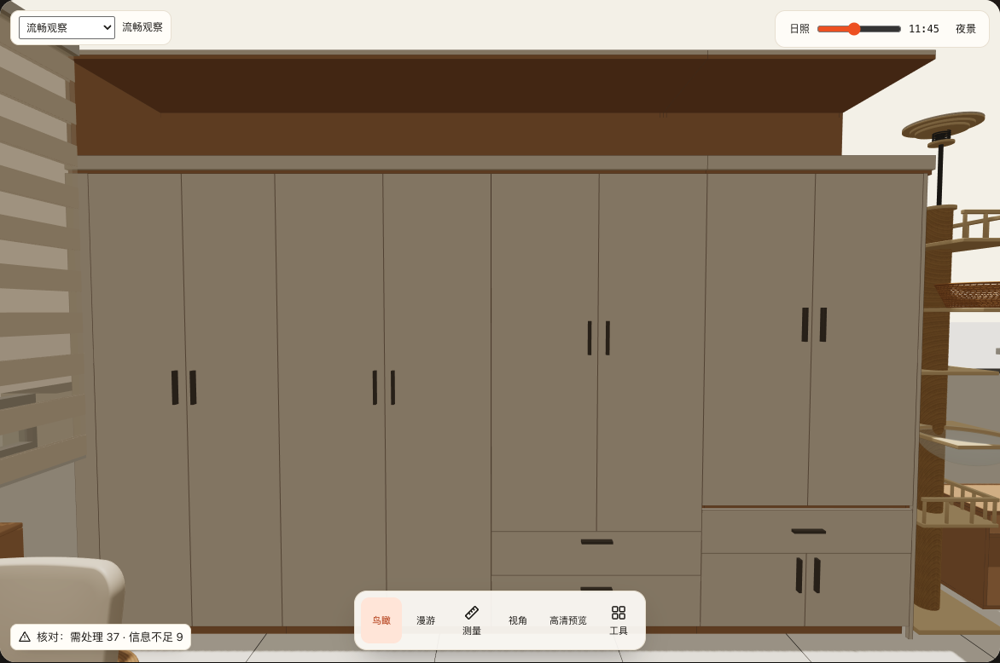
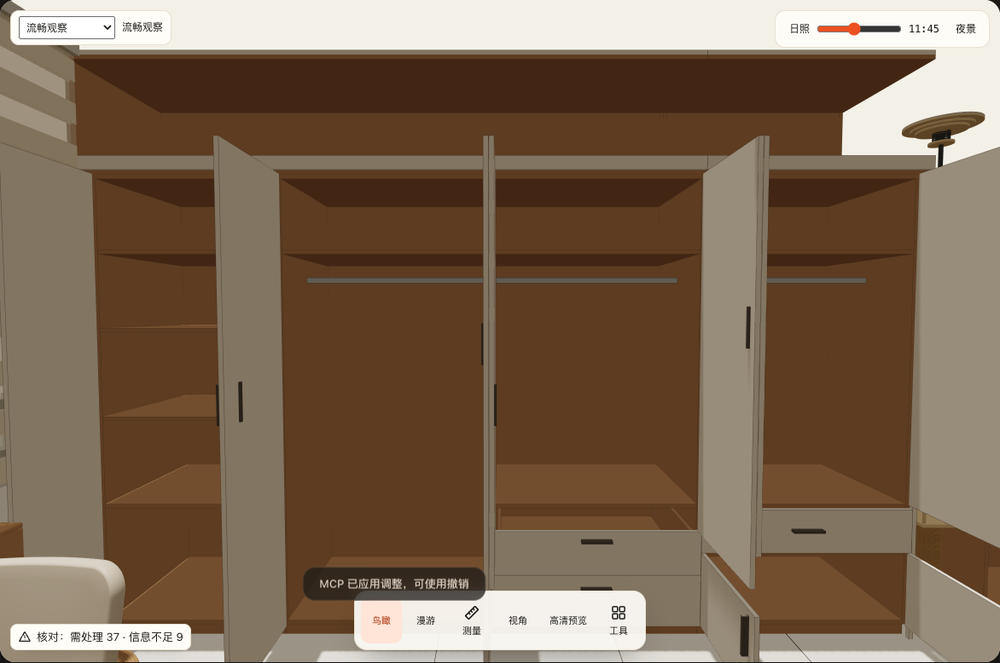

# 1601 主卧到顶衣柜与猫廊改造
日期：2026-11-18。正式方案副本：**1601 · 主卧到顶猫廊与父母挂衣优化**（dmwlgkelu）。原方案“1601 · 厨房门窗衔接示意 · 轨宽待定”保留。

## 需求与结论
父母56岁、身高1650mm，以挂衣为主，需要被褥与包；一只1岁约4kg、跳跃良好的猫；主卧不做吊顶，猫通道融入柜体，所有窗帘保持原配置。

推荐保留西侧四柜占地，以2100mm高储物主体承托540mm高的顶层猫廊，而非在2450mm旧柜上直接加低矮通道。模型原顶2700mm、完成地面60mm，净高2640mm；旧柜顶到原顶仅190mm。上述来自项目，尚未现场复尺。

完整模型宽3821、深630、完成高2640mm：下部四箱821+950+950+950，加北端100mm与南端18mm见光／收口占宽，共3789mm；顶层3821mm，向猫爬架方向多出32mm。北端原50mm预留增加至100mm，相应该箱由871缩到821，未把收口并入侧板厚度。该100mm是本案试配值，板厚、安装及具体见光节点待柜商复核。

## 柜内布局
面对柜子，从北侧窗边向猫爬架方向：
| 分区 | 箱体外宽 / 净宽 | 建议用途与实际尺寸（mm） |
| --- | --- | --- |
| 被褥、包 | 821 / 785 | 底格净高522（78–600）放被褥袋；上方净高382、382、332的格子放包和可调收纳。常用包优先618–1400范围；1768以上只放轻且不常用物品。 |
| 长挂 | 950 / 914 | 杆轴1650；底板顶78，杆轴以下1572。最长外套仍应连衣架实量。上方1750层板，顶格净高314。 |
| 短挂与两抽 | 950 / 914 | 杆轴1650，承托层板顶618，杆轴以下1032；底部两只220mm面板抽屉，供低频小件，避免将最下抽屉当父母高频区。 |
| 短挂与独立抽屉 | 950 / 914 | 同样1032mm挂衣落差；独立抽面400–600、200高；下部净高304放低频物品。 |

三根杆中心均1650mm，每根实际长910mm，共2730mm。柜内闭门口径净深594mm。保留普通固定杆，不把需抬手取放的1900–2000mm上杆作为日常主力；先拿实际衣架让父母试挂，必要时在模型内微调杆位。固定杆为方截面布局表达，未包含真实支座与承重验算。

不把1650mm说成适合所有165cm使用者的标准。肩部活动、衣架钩和衣物长度均影响舒适度；也不因56岁自动假定行动不便。被褥用带提手轻便袋，避免放到猫廊或高处；若实际被褥体积超过785×594×522，应调整相邻分区，不以压缩袋能力作保证。

## 猫廊与上下路线
- 地板顶离完成地面2118、顶板底2602，净高484mm；整个通道外长3821mm。
- 内部地板深612mm；前沿18mm厚、60mm高低护边以内约594mm。护边只减小日常滑落风险，不能阻止猫主动跳下或代替完整防坠措施。
- 顶层两箱以实际侧开口贯通，连接处不保留封闭的整片侧板；地板同标高，不要求猫穿衣柜储物格。
- 三侧围合、正面开放观察，暖白门面与木色内腔衔接现有猫爬架。适合行走、转身、趴卧、观察与轻度玩耍；顶高限制了跳跃和直立伸展，不称为完全不受限的跑酷场。
- 现有猫爬架沿原方向朝睡眠区平移30mm（cy5568→5538），清除端部见光板与右碗托板原11mm干涉。其结构/型号不改。爬架顶层平台约1800mm为原产品模型估算，上到2118廊面约300mm高差；实际落脚面、水平跨距与防滑必须现场试走，模型不模拟猫跳跃。
- 设计建议铺可拆换防滑垫、圆滑封边，避免长绳或悬挂玩具。垫厚会减小净高；本模型未表达垫子、圆角加工与节点五金。水碗和猫砂仍留其他原区域。
- 正面开放便于伸缩除尘与吸尘头进入全深，少设细碎迷宫；不要求父母踩椅清洁。保留可维护拆装节点，避免封死救助和检修路径。

## 调研与来源
小红书均实际读取了笔记正文，未取得原图及图中尺寸，不能宣称看过配图或据此验证完工效果。以下沿用搜索结果完整访问参数：

1. [canoe：衣柜顶部不吊顶而是专属猫咪跑道pt2](https://www.xiaohongshu.com/search_result/6a6d9662000000002402cf22?xsec_token=ABN36NDe9d4WtDWJOt_e35_PGAqnFztkrup3z3-_vasIM=&xsec_source=)。作者提及取消柜顶吊顶、追求柜墙整体性与清洁；其现行清洁方式仍是梯子与除尘掸。本案采纳“顶部与柜体统一、简化细碎构造”，将登高清洁问题单独解决。
2. [CC的装修日记：全屋定制封神！顶层猫走廊直接省出一间猫房](https://www.xiaohongshu.com/search_result/6961b07b000000001a02287f?xsec_token=ABSWkbcQw1WaC9bsxeWZYjV6ljh00UlVzWKgHDHJ-XUVo=&xsec_source=)。正文声称250mm宽贯通通道；仅作案例线索，不作为猫舒适度、承重或防坠标准。本案明显加宽，保留转身与趴卧空间。
3. [半隐拾光：挂衣杆多高？身高加20公分](https://www.xiaohongshu.com/search_result/6aeb2b6d0000000016030b76?xsec_token=ABz4IZ8Cvq6KVA4OrwZ07hK5IoMwCVjQjj9vPWOKcnfCM=&xsec_source=)。正文主张先统计长短衣与取物区。未照搬“身高加20cm”公式、极限伸手值或全部五金意见，采用本人试挂确定杆位。
4. [AAFP/ISFM：Your Cat’s Environmental Needs，宠物主人实用资料](https://catvets.com/wp-content/uploads/2024/01/Environmental%20GuidelinesEViewFinal.pdf)。建议高处安全休息、可选择进出、资源分离及捕猎游戏；这些行为原则支持增加高处活动层，不提供本案484mm、594mm等固定尺寸。
5. [IKEA PAX & KOMPLEMENT 购买指南，第2–3页](https://www.ikea.com/gb/en/files/pdf/70/6b/706b9e9c/ukpax_komplement_buying_guide_a4.pdf)。列出约800mm衬衫、1000mm外套、1200mm短裙与更长衣物的占高示例；仅用于分区起点，仍按父母实际衣物核对。其PAX组装/固定要求不直接外推为本定制柜施工参数。

## 实施与验证
通过 Furnish MCP 在具名副本修改并取得 persisted:true；移除副本内主卧睡眠区吊顶，其余吊顶不动。三件旧衣柜记录整合进原首柜ID的六箱组件树（四下柜、两上柜）；原方案保留四件旧记录。北窗斑马帘恢复为cy9513.5，全部窗帘与调研前记录逐项一致，其余非目标家具无差异。未改应用代码。

已通过：
- 组件结构和完整尺寸链校验；读取91件柜体与60件猫爬架生产实体，逐件保守AABB无正体积相交。
- 真实生产板面净高、挂杆、侧开口、护边核对；项目pack/unpack往返完全一致。
- 正式桌面关闭与开门视图已实际查看，同机位图见下；开门查看后恢复关闭并保存。
- 原窗帘位置下，柜门／抽屉完整行程专项未再报告碰撞，猫爬架实体碰撞消除。
- 剩余整组“正面800mm使用空间不足”一条提示未忽略、未自动确认；专项未报冲突不等于柜前所有使用姿态已经验证，需结合北端书柜/椅子现场评估。

未执行：现场复尺、猫实际试走、父母衣架试挂、五金加工/负载/动载验算、Blender导出回读、应用全量回归。此任务为方案设计，不将几何可用表述为可直接施工。顶层长板、收口固定及侧开口加固须由柜商深化，不能把软件18mm板厚当作跨度承载结论。

证据：proposed-furniture.json（组件方案）、furniture-snapshot.json（MCP最终家具读取）、geometry-check.json（生产实体与净尺寸）；完整项目由MCP另行导出到本机固定导出目录。
