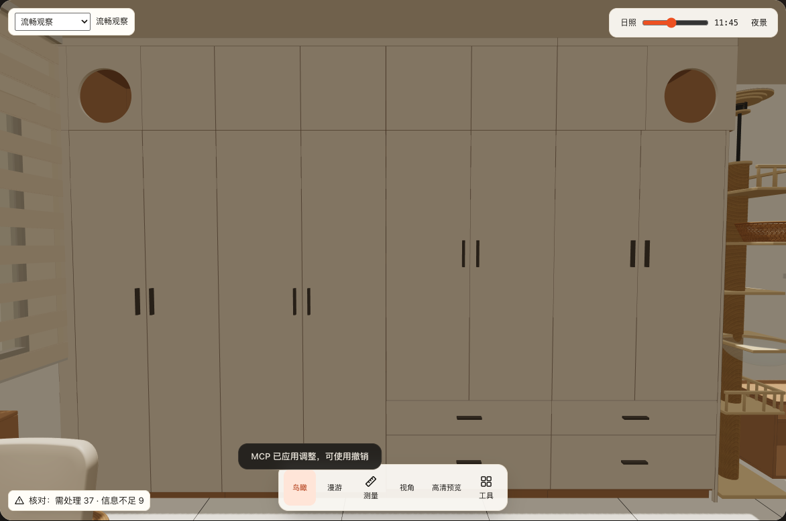
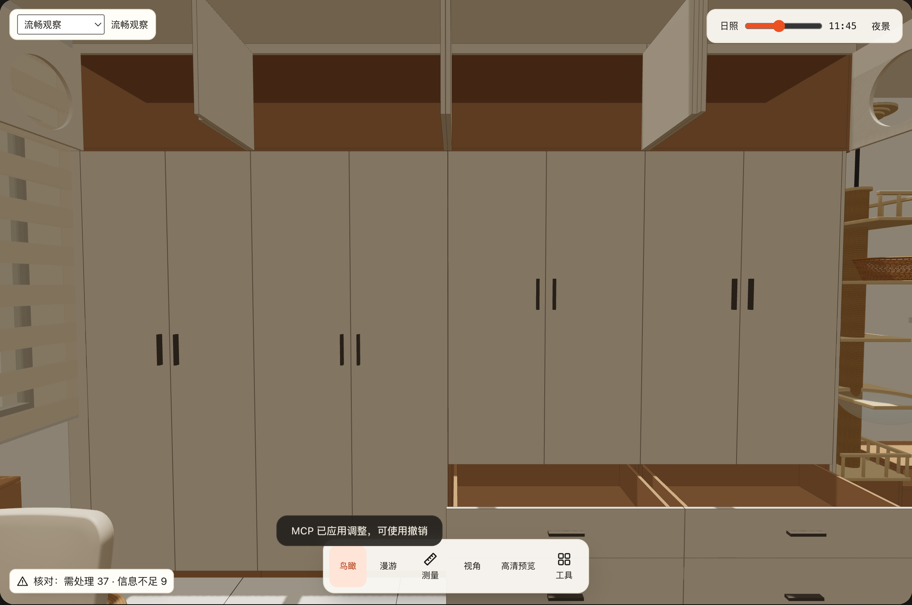

# 1601 封闭猫廊、450净高与抽屉修订
2026-11-18。副本：**1601 · 主卧封闭猫廊与柜门猫洞**（dmwlj2pv0）。上一版开放方案与原方案保留。本轮只调整同一家具ID fmvvt0mto1 的组件树及其方案讲解，其他家具（含全部窗帘、猫爬架和通道灯）逐项一致。

## 最终尺寸与组件关系
- 四下柜与两上柜仍在同一柜体组件树，猫廊上箱通过 attach 连接下箱，不是独立漂浮家具。
- 下柜完成高 **2134mm**，猫廊箱高 **506mm**，整柜完成高2640mm。猫廊下板顶2152、顶板底2602，**真实板面净高450mm**；不能把506箱高当净高。
- 用户补充猫坐高350–400mm，未铺垫时余量50–100mm。软垫厚度从净高扣除。450为用户指定方案值，不是动物福利统一标准。
- 下柜增加34mm，但10根原挂杆／活动层板的实际标高保持；三根挂杆仍1650mm。短挂区上方600mm固定承托板保留，改为固定结构用途，避免活动层板与抽屉组共享自动分层。
- 前门关闭口径净深约594mm；上层箱体原内部侧开口保持贯通，最南外侧封闭。未给猫廊增加中间竖隔板。

## 门板、猫洞与维护
正面增加八扇侧开门，暖白与下部统一；北端100mm固定见光／收口与下柜对齐。两处约300mm直径猫洞分置靠北及猫爬架端门板，下沿高出廊面22mm，作为通行／观察及空气路径。300为本案初配，尚需按猫体型和落脚面试走，不能由4kg体重推导合格孔径。未采用会摆动夹尾的宠物门 flap。

门上45mm固定封板使可动门顶保持在2594mm、避开通道灯底2605mm。模型按90°侧开检查，不移动灯具或窗帘；铰链、反弹器、安全锁闭、孔边圆滑封边和开启时让猫离开均需厂家深化。原低护边删除，避免挡住猫洞下缘；前部由完整门板围合。

全部顶层门可独立打开取垫、吸尘和检修，未设计父母日常登高。两孔及常规门缝提供开口，**未验证换气性能**，后续按使用情况决定是否补通风孔。圆孔模型以96边界近似，最大径向误差约0.081mm；物理加工按连续圆孔与完整板件处理，不按网格分片拆单。

## 抽屉重新划分
原最南柜“抽屉下方对开门”取消。两组短挂柜底部各放两只可独立拉出的明抽，共4只：
| 用途建议 | 名义高度 | 生产抽面范围 / 实际高 |
| --- | --- | --- |
| 上抽：贴身小件、袜子 | 200mm | 399–597 / 198mm |
| 下抽：低频叠衣 | 320mm | 79–397 / 318mm |

不再用抽面高度代替抽内净高。抽盒、滑轨、有效深度和承重需依据选定五金；四只为当前初配，不宣称已按家庭物品清单核定。上抽约400–600mm仍偏低，受短挂区1032mm衣物落差约束；不把它称作父母最舒适的腰部抽屉。常用包可放北柜600–1400mm。若后续希望日常小件在腰部取用，应从非挂衣区重新分配抽屉，不将挂衣杆抬高来挤空间。

## 小红书依据与边界
本轮重点检索“封闭衣柜猫跑道／柜门开洞”，实际读到：
- [集禾定制：柜子挖圆洞｜在阳台搭建猫咪快乐星球](https://www.xiaohongshu.com/search_result/6a53225f000000001502628b?xsec_token=ABc__ZVGx4EAauDAVdQqHa2yYTf5L8JxREIFW5M6uAwG4=&xsec_source=)。正文明确描述柜门圆形镂空、内部错落隔板、顶部透明封闭猫廊；属于定制商案例描述，未独立验证完工效果。
- [学校小卖部里吃过亏：柜子里的猫洞](https://www.xiaohongshu.com/search_result/690dd1880000000005003970?xsec_token=ABqVXcMzqMwh3AyK5m5wvQq29e_7m9RMpT6dYcRT4hKDs=&xsec_source=)。正文提到全屋衣柜的猫洞，未提供可用尺寸。
- [三三喵记：衣柜与猫爬架的完美结合](https://www.xiaohongshu.com/search_result/6789b7d5000000001901f57a?xsec_token=AB6q99kAf8BKoB5nwB1L_O1n09S34gDy-Mn9spfXQ58nU=&xsec_source=)。正文仅有话题标签，不将标题当作内部结构、孔径或净高证据。

以上仅读取正文，未取得配图，不能宣称已看图或沿用其尺寸。旧版猫环境／衣物占高资料仍见[上一版调研](../master-wardrobe-cat-20261118/README.md)。

## 验证
已通过组件与项目往返校验；295件生产网格实际射线检查两猫洞中心为空、邻近门板为实体。两处猫廊生产板面净高均为450；下箱均2134；原挂杆与活动层板标高不漂移。四只抽屉面高来自生产板件。

正式桌面已实际打开顶层八门和四抽查看，后恢复关闭并保存。完整门抽扫掠无新增窗帘／通道灯碰撞。仍有原“整组正面800mm使用空间不足”一条提示，未自动忽略或确认。方案讲解已更新并重新采图；正式GLB读取295件目标柜体网格，身份唯一，整体高度含完成地面基准为60–2700mm。此项不等于Blender回读通过。

未执行现场猫试走、父母取物试用、通风或载荷验算、五金加工校核、Blender回读及应用全量回归。本轮无应用代码、模板默认值或持久格式修改。

