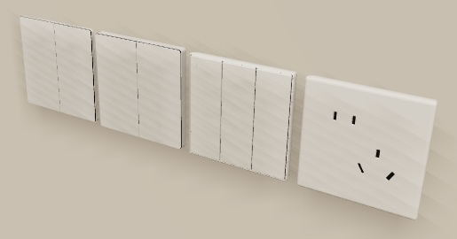
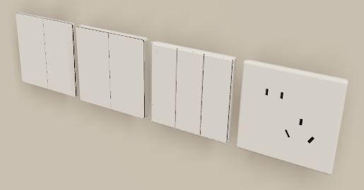
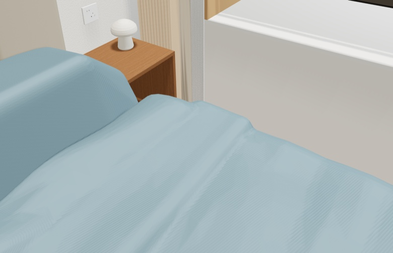
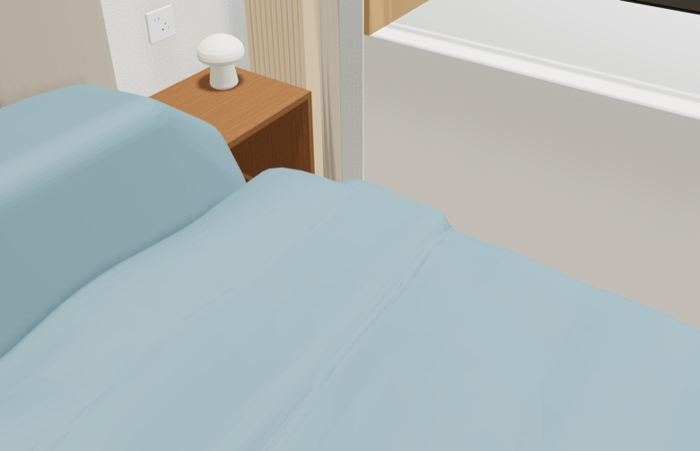

# 实时三维自阴影条纹

2026-11-23。用户报告玄关开关面板出现重复斜纹。独立光照场景使用生产公牛 G12 与小米智能开关网格，在两个方向的斜照下复现；1601 主卧飘窗旁被面在桌面实景中也复现了细密条纹。

原软阴影过滤依次读取周围多个深度像素，却对每个像素使用同一处接收深度。光线斜照时，同一个面的深度随阴影坐标变化，过滤结果会随阴影网格周期起伏。实时三维现在从该三角面的投影求深度梯度，在每个实际采样像素的中心比较遮挡深度。主日照、筒灯、面光和灯带绑定的聚光阴影共用此计算。各灯仍沿用原贴图分辨率、软化跨度、深度偏移、表面法线偏移及缓存更新条件。与光线近乎平行、无法稳定求梯度的面沿用原深度比较。

| 同机位样本 | 修正前 | 修正后 |
| --- | --- | --- |
| 公牛、小米开关和斜五孔，独立直接日照 |  |  |
| 1601 主卧飘窗旁，13:30 |  |  |

## 增量验证

- WebGL 回归使用生产小米 2 Pro 面板、2048 和 4096 两档日照贴图及 512 聚光灯贴图。每种配置在预先选定的 6600 个按键内部像素中均复现旧着色偏差，修正后与无自遮挡参考的差值均低于 4 个八位色阶。单独放入遮挡物仍会把阴影投到面板上。沿用现有 Playwright 浏览器配置执行 `node tests/test-raster-shadows.cjs --webgl` 可复测。
- macOS 桌面使用快捷方式指向的打包程序、独立源码、端口和缓存，读取 1601 正式文件副本。核对玄关 E65／E51／E35 的两个日景角度及夜景、走廊梁墙与地砖、飘窗和床品、餐边柜，以及厨房日景／夜景的柜门、墙砖、插孔和台面。测试角度下玄关面板位于阴影区，面板条纹由上面的直接日照对照复现。真实分缝、窗框和梁墙交界的投影仍可见。正式文件前后 SHA-256 一致。
- 通过生产桌面本地 HTTP、Chrome 离线 `file://`、阴影着色器组合及安装幂等、阴影缓存、室内日光、顶灯、浴霸、灯带、梁高、飘窗和两类面板的增量测试。改动针对实时 WebGL，项目文件、生产几何和导出格式沿用原合同。有限阴影分辨率仍决定遮挡边缘的精细程度。本次验收为上述区域及灯位抽样。
