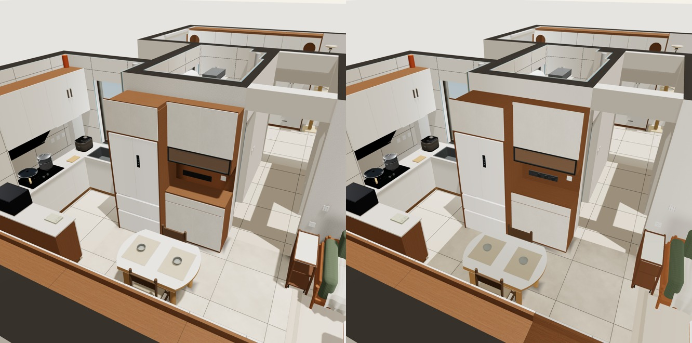
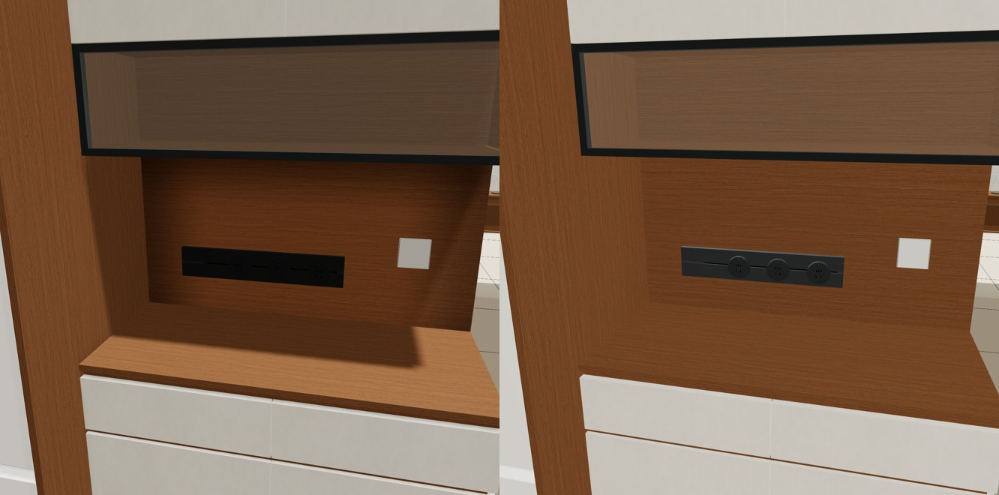
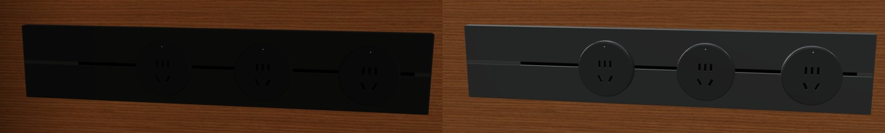

# 1601 餐边柜日光与轨道插座

2026-11-23。桌面实时三维在餐边柜开放格复现了两种暗区。背板的侧边与上缘由固定比例的着色函数压暗，台面还收到从剖视敞口照入的方向光投影。

客餐厅地面、家具与朝向室内的涂装墙面用现有窗洞尺寸和太阳方向计算直射范围。穿过窗洞的光继续使用原实体投影。室内间接光沿既有窗光分布平缓衰减，开放格与其它板面使用同一套受光计算。

公牛 GB50K 继续用原始网格和 PBR 材料。实时材质缓存为金属轨道、外环和外露的模塑零件提供环境反射，深槽和插孔保留原暗面。轨道左段固定取样区的 8 位亮度均值从 9 升至 37。反射随原有日夜强度变化。GLB 清理阶段沿用原有材质导出契约。

## 同机位桌面对照

左侧为修正前，右侧为修正后。场景使用 1601 的正式方案副本，按已保存的太阳参数设置 12:30，关闭室内灯，鸟瞰隐藏吊顶。

## 验证范围

- 使用 macOS 桌面快捷方式所指向的同一 Furnish 打包程序和隔离回环服务。检查鸟瞰、开放格近景、插座特写、09:30 日景及开主灯夜景。厨房水槽机位的前后图像逐像素一致。桌面渲染无着色器报错，正式方案的 SHA-256 一致。
- Chrome WebGL 窗洞夹具确认落在窗宽及窗台／窗头之间的日光仍照亮地面。旁侧、窗后及高于窗头的射线仅保留间接光。Chrome 离线直接打开并进入三维通过。
- 通过室内日光、GB50K 实体与项目往返、阴影着色器、阴影缓存、灯光规划、高清快照及吊顶光源的专项检查。范围为 1601 客餐厅实时三维和 GB50K 的实时反射，间接光仍为近似。未运行全仓、窄屏或离线路径追踪出图。
