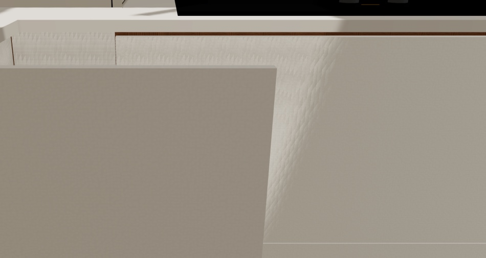
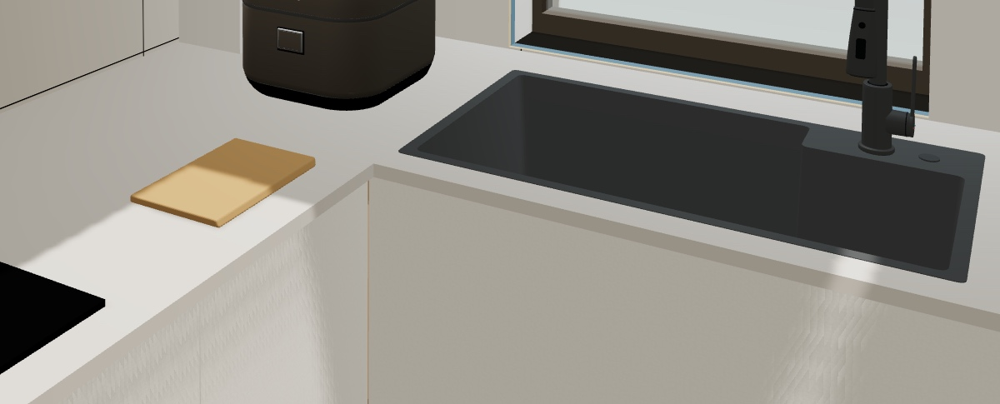

# 柜门上的软阴影锯齿

2026-11-23。在 1601 厨房的灶台下方和水槽转角复现。停用柜门微表面凹凸后，三角纹仍出现在日照阴影的过渡区。临时使用标准半径时，三角纹消失，遮挡仍能投影。

原加宽滤波扩大了贴图采样点的间距，权重仍以单个贴图像素为周期。接收面跨过贴图像素边界时，采样集合和权重一起跳变。现在由公用 WebGL 阴影着色器按连续覆盖面积计算权重，使用加宽范围内相邻的深度样本。保留逐采样点接收面深度校正。标准半径保持 3 个贴图像素的覆盖宽度，本厨房饰面的加宽覆盖为 4.9 个像素。贴图分辨率、场景光照、几何及材质沿用原值。

| 1601 桌面同机位 | 修正前 | 修正后 |
| --- | --- | --- |
| 灶台下方柜面，11:00 |  |  |
| 水槽转角，13:00 |  |  |

## 验证范围

- 同一打包 macOS Furnish 使用正式 1601 文件的隔离副本。复核灶台 11:00／13:00、水槽转角日景与夜景、走廊梁墙及地砖。夜景前后 PNG 的 SHA-256 相同，正式方案文件哈希相同。桌面本地服务与 Chrome 断网直接打开均通过。
- Chrome WebGL 斜投影试验衡量 160 个像素列。旧版有 1644 次相邻像素亮度反向跳变，修正版为 0。共有 6735 个过渡像素，标准半径有 4289 个，表示修正后的阴影仍更柔和。用 `node tests/test-raster-shadows.cjs --webgl` 可复测。原开关自阴影、两档日照贴图、聚光灯及独立遮挡物负例同轮通过。
- 在水槽转角机位以 1672 × 1658 像素进行热态同步绘制，每版 28 个样本。前后中位数均为 2.3 ms，P95 均为 2.8 ms。测量范围为该固定机位的单次绘制。
- 通过阴影着色器组合、室内日光、阴影缓存、面光与灯带等专项 Node 检查。本次为桌面宽度及灯位抽样，实时阴影边缘的细节仍受贴图分辨率限制。
