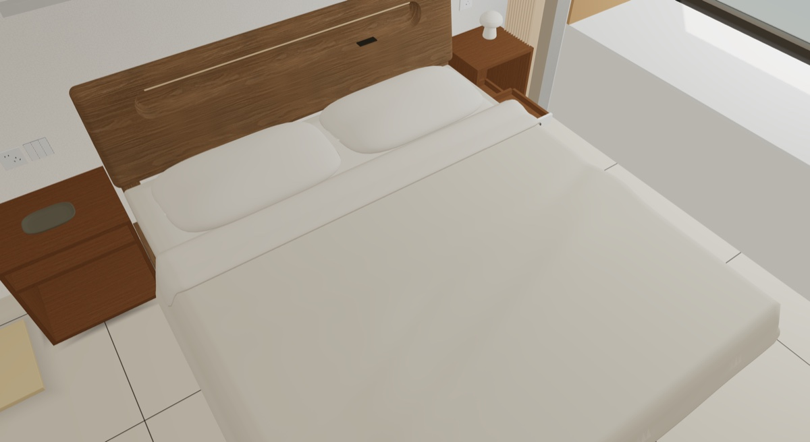
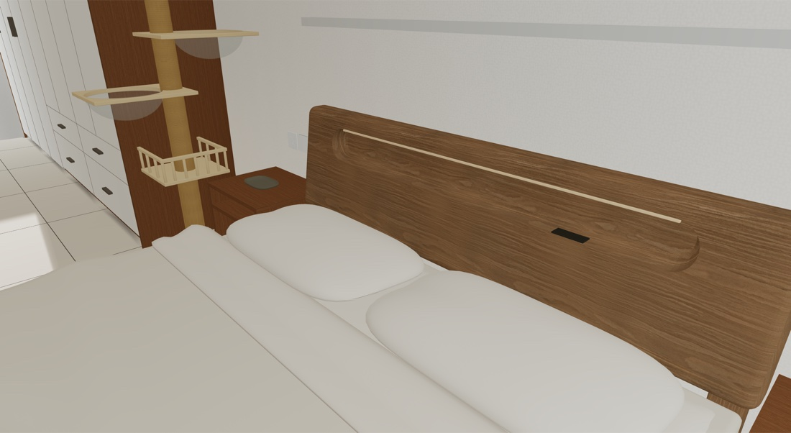

# Y83B33 床架与米白床品的组合复核

2026-11-24 基于 [品牌商品图](https://yeswoodhome.com/products/yws-696045565660) 的三处识别特征复核。已实际查看 [主图](../../../assets/models/bed-yeswood-y83b33/references/hero.jpg)、[侧面](../../../assets/models/bed-yeswood-y83b33/references/side.jpg)、[置物槽](../../../assets/models/bed-yeswood-y83b33/references/headboard.jpg)、[商品参数](../../../assets/models/bed-yeswood-y83b33/references/dimensions.jpg) 和 [结构](../../../assets/models/bed-yeswood-y83b33/references/storage-construction.jpg)。商品照的光照相机与床品具体型号未知。Furnish 两个机位与首轮 1601 对照尽量一致，分别看主体与床头局部。

| 识别特征 | 初版情况 | 最终检查 |
|---|---|---|
| 侧视斜靠与槽深 | 床头竖直，凹槽和板面明暗接近 | 床头以照片估算的 8° 后倾，保留实体置物槽、圆角、充电口和独立灯带 |
| 顺板木纹和悬浮底座 | 单色木板，板件方向感弱 | 生产床头、床帮、床尾和立撑有定向橡木纹，底座向内收并保留踢脚避位 |
| 床面分层 | 首轮库样为裸架，旧方案床品用蓝色单体 OBJ | 独立米白床垫带两道围边，两只独立枕头，暖白被子带独立折边和自然垂边 |

导入组合副本并保存恢复后，可按家具组移动五件物品，沿原解组入口分别调整。独立摆放位置使用同一 1601 房间的复制数据，正式方案未写入。组合文件在本机 output/y83b33-composition.noindex 中。生产 GLB 中五件家具 ID 分开，保留 12 张图片及 16 个带法线纹理的材质记录。最终桌面截图与生产导出见 output/desktop-verification.noindex/room-raster-U97IGG.noindex。

橡木外观复用已有白橡木纹理并暖色调色，用于近似图中红橡木。GLB 作者源使用分区基础材质，贴图由 Furnish 生产构造绑定并参与正式导出。床头凹槽和铺板为实际实体，灯带和储物按闭合静态展示。合铺位置会产生枕头、被子和床垫之间预期的局部接触；案例范围不包含布料动力学及掀起储物盖时的扫掠。

四款型号的增量整链路已通过，覆盖独立发布、空间实体、HTTP 与断网 file://、生产 GLB、Blender CPU 三机位及下载工程回读。报告见 output/model-pipeline/selection-aaldFR.noindex/batch.json。隔离桌面按型号搜索看到四条，按完整床架货号添加并保存刷新通过。未执行全量及窄屏。家具库旧泛用浏览测试在修改前后均因宠物筛选多返回三个晾晒条目而失败，Y83B33 的独立桌面及分类检查通过。
